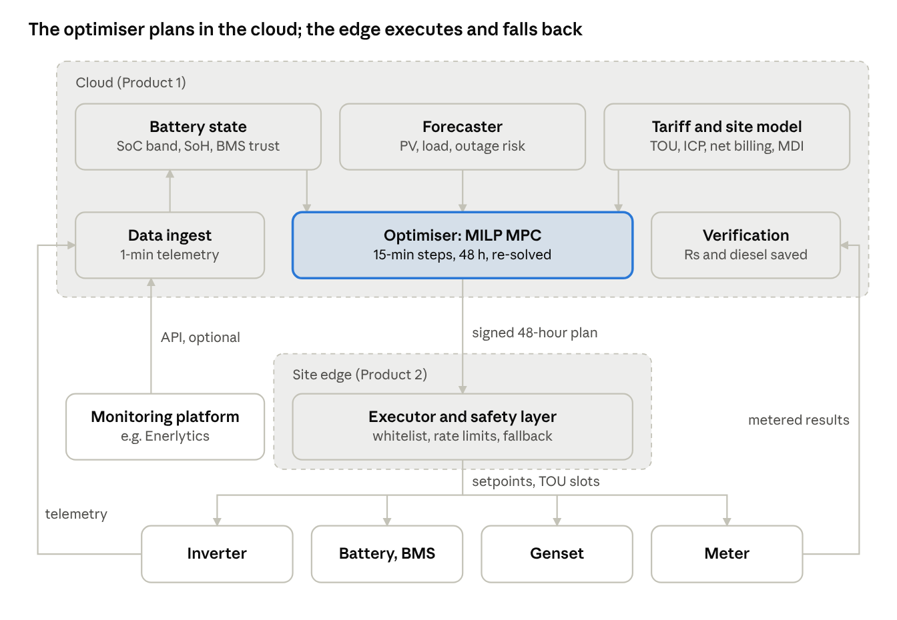

# Product 1: TOU-Aware Energy Management and Dispatch

Oct 30, 2026 · @Onyxleaf Claude AI and Mechanical

## Summary

Verdict: pursue Product 1 as a field pilot, reframed from a "TOU optimiser" to a cost-aware dispatch optimiser for sites with outages and gensets. Pure TOU arbitrage in Pakistan nets Rs 4.8 to 10.3 per kWh, about the Rs 7.5 to 10.8 of battery wear it causes.

A 100 kWh battery at a B-2 industrial site earns about Rs 1,031 a day from grid-charged TOU arbitrage (October 2026 inputs). The same battery earns about Rs 2,346 a day storing net-billed PV, and about Rs 11,685 on a day it replaces diesel. So the product must win outage, genset and self-consumption decisions; TOU timing is one input among four.

Enerlyticslab monitors these assets and forecasts load shedding, but no source shows it sending setpoints to inverters, batteries or gensets. NeoTAQ, sold by Green Fuel Energy, already runs rule-based hybrid and battery dispatch at a claimed 50+ Pakistani sites. No vendor-neutral, forecast-driven, tariff-aware optimiser was found in Pakistan or Saudi Arabia.

| # | Finding | Key number | Source |
| --- | --- | --- | --- |
| 1 | TOU arbitrage barely covers battery wear | B-2 nets Rs 10.3/kWh, A-2(c) Rs 4.8/kWh; wear Rs 7.5 to 10.8/kWh (6,000-cycle assumption) | [IESCO tariff guide, SRO 279(I)/2026](https://www.iesco.com.pk/tariff-guide), [SolarCitizen, Oct 2026](https://www.solarcitizen.com.pk/lithium-battery-price-pakistan/) |
| 2 | Net billing makes self-consumption the main grid value | Exports valued at Rs 8.13/kWh in NEPRA's Apr to Jun 2026 adjustment vs import Rs 35.68 to 43.82; PV shift worth Rs 23 to 35/kWh | [NEPRA SRO 1501(I)/2026](<https://nepra.org.pk/tariff/Tariff/Notifications/2026/09%20Sep/SRO%201501(I)-2026%20Dated%2007-09-2026.pdf>) |
| 3 | Genset displacement dominates on outage days | Diesel Rs 400.67/L (30 Oct 2026) gives Rs 110 to 142/kWh; outage-day value 11 times arbitrage | [Daily Pakistan](https://en.dailypakistan.com.pk/29-Oct-2026/new-petrol-diesel-rates-in-pakistan-for-october-30), [Enpower](https://enpower.com.pk/how-to-calculate-diesel-generator-running-costs/) |
| 4 | Maximum-demand fixed charges are a hidden stream | Rs 1,250/kW/month; a 25 kW MDI cut is about Rs 375,000/yr where MDI sets the charge | [IESCO tariff guide](https://www.iesco.com.pk/tariff-guide) |
| 5 | Evidence that an optimiser beats the inverter's own mode is thin | Hardware test in 4 reproduced homes: rule, decision-tree and MPC costs within 0.6%; for hourly schedulers, MPC's edge shrinks 69% when re-scored at 1 minute | [Ruddick et al. 2024](https://arxiv.org/abs/2408.07435v1), [Pinter et al. 2025](https://arxiv.org/abs/2510.25373) |
| 6 | Saudi Arabia has no business TOU | Industrial 20 halalas/kWh (23 from 1 Jan 2027), export 5 halalas; about SAR 4,300 to 5,200/yr per 100 kWh battery | [MEED](https://guest.meed.com/saudi-arabia-raises-electricity-tariffs/), [Haala Energy](https://haalaenergy.com/saudi-ci-solar-regulations/) |

Where the money is, ranked by rupees per kWh of battery throughput:

1. Outage and genset displacement: Rs 110 to 142/kWh. A kWh held for a forecast outage is worth about Rs 106 more than spending it on the B-2 peak.
2. Net-billing self-consumption: Rs 23 to 35/kWh. The inverter's self-use mode already captures most of it; the increment lies in charge timing.
3. Maximum-demand (MDI) fixed charge: Rs 1,250/kW/month, only where MDI sits above the sanctioned-load floor.
4. Pure TOU arbitrage: Rs 4.8 to 10.3/kWh gross, near zero after wear, and zero on units under the flat incremental package.

Where the money is not: schools and hospitals on A-3 have no TOU option, and D-2(b) tubewells see a Rs 0.85 spread. Legacy net-metered sites still net exports at about Rs 25, and Saudi C&I tariffs are flat.

The evidence gap is the main risk. MPC beat rules mainly where peak charges applied: 13.9% vs 5.2% in one simulation ([Pérez-Piñeiro et al. 2023](https://arxiv.org/pdf/2307.07580)). No vendor A/B against an inverter's native TOU mode was found, so the pilot must measure that increment first.

## Refined problem statement

The meeting's idea, "reproduce Enerlytics with TOU", needs six corrections once 2026 tariffs, outages and net billing are applied. The result is a dispatch problem with four value streams, of which TOU is the smallest.

### What the research changes

- TOU applies only to some categories: A-1 residential at 5 kW and above, A-2(c) commercial, B-1(b) to B-4 industrial, C bulk and D agriculture ([IESCO](https://www.iesco.com.pk/tariff-guide)). Schools and hospitals on A-3 pay a flat Rs 42.48/kWh.
- The Incremental Consumption Package (ICP) prices industrial and agricultural units above baseline at a flat Rs 22.98 until about December 2028. Arbitrage on those units is worth zero; NEPRA reviewed the package on 5 October 2026 ([Express Tribune](https://tribune.com.pk/story/2633172/nepra-reviews-incremental-consumption-package)).
- Load shedding sits in the evening peak. The April 2026 relief window ran 5 pm to 1 am, so reserve and arbitrage compete for the same kWh ([Profit](https://profit.pakistantoday.com.pk/2026/04/14/5pm-1am-peak-load-shedding-govt-announces-up-to-2-25-hour-daily-outages)).
- Net billing (9 February 2026) splits sites in two. New prosumers export at about Rs 8 to 11; legacy net-metered sites kept near unit-for-unit netting under a draft amendment.
- Saudi Arabia has no business TOU and credits PV exports at 5 halalas.
- Off-grid and remote sites have no tariff at all; their decision is when to run the genset.

### Problem statement

C&I and remote sites in Pakistan run PV, lithium batteries, unreliable grid and gensets on fixed inverter rules, and lose money daily. Four decisions drive it: when and from what to charge, when to discharge, when to run the genset, and what reserve to hold. Product 1 makes these decisions every 15 minutes from forecasts and the actual tariff, and proves the saving against the inverter's own mode.

### Scope

| In scope | Out of scope |
| --- | --- |
| Grid-tied C&I on TOU (A-2(c), B-1(b), B-2, B-3) with PV, battery and optional genset | PV structure design (on hold) |
| Flat-tariff sites with outages and gensets (A-3 hospitals and schools, A-2(b) shops) | Homes (free OEM apps; SolarAssistant-level price ceiling) |
| Remote diesel-hybrid sites (farms, off-grid industry) as pilot 1b | Utility-scale, front-of-meter and wholesale trading |
| Tariff and regime model: TOU windows, ICP, net billing vs net metering, MDI | Device drivers, edge hardware, register maps (Product 2) |
| PV, load and outage forecasts | Battery and PV sizing studies |
| MILP rolling-horizon optimiser with genset, outage, MDI and wear terms | EV charging and HVAC load control |
| Independent battery-state check used by the optimiser | Saudi C&I arbitrage (no TOU) |
| Plan delivery: daily inverter TOU slots first, 15-minute setpoints via Product 2 later | Grid-tied tubewells on D-2(b) (flat tariff) |
| Savings verification against the inverter's own mode | Telecom tower fleets as a first market |

### First target buyer

Segment 1 is grid-tied industrial and commercial sites on TOU tariffs B-2, B-3 or A-2(c) with PV, 100+ kWh of battery and a genset. They sit on feeders with load shedding; typical buyers are textile, food, beverage and rice-processing plants.

- They stack all four streams: outage reserve, PV self-consumption, MDI and some TOU timing.
- Industrial storage is growing: its share of lithium imports rose from 3.2% (2025) to 13.9% (January to May 2026) ([Pakistan Solar Association](https://www.pakistansolarassociation.org/pakistan-lithium-ion-battery-import-market-a-17-month-analysis-jan-2025-may-2026-imports-hit-5-39-gw-as-battery-energy-storage-demand-explodes/)).
- Named buyers exist: Liberty Mills (30 MWh), Gadoon and Sapphire Textile (25 MWh each), Lucky Cement (22.7 MWh), Shabbir Tiles (20 MWh).
- They have energy managers, buy on ROI, and are served by Green Fuel Energy, Enercon and Enerlyticslab.
- They mix brands: Haideri Beverages runs 7 Huawei and 6 SMA inverters with 5 gensets ([GFE blog](https://gf-energy.com/blog/neosync-vs-epowercontrol-sd-solar-hybrid-controller-comparison)).

Segment 1b is remote diesel-hybrid sites, where the manager's "off-grid, remote" demand sits. Telecom fleets come later, because operators and towercos buy integrated systems such as Huawei's (1,000 Jazz sites) and Reon SPARK (5,500 towers).

## Market context

Pakistan's tariff gives industrial TOU sites a Rs 12.85/kWh spread, while a new prosumer's export credit sits Rs 27.55 below the B-2 peak. That gap, plus genset fuel at Rs 110 to 142/kWh, sets where an optimiser earns money.

### Tariffs in force (base rates, before adjustments and taxes)

One national schedule, SRO 279(I)/2026 (February 2026), covers all ex-WAPDA DISCOs and K-Electric until end-December 2026 ([IESCO tariff guide](https://www.iesco.com.pk/tariff-guide); [NEPRA decision, 11 Feb 2026](https://nepra.org.pk/tariff/Tariff/Ex-WAPDA%20DISCOS/2026/TRF-100%20XWDISCOS%20AND%20KE%20RATIONALIZATION%20OF%20TARIFF%2011-02-2026%202935-57.pdf)).

| Category | Peak Rs/kWh | Off-peak Rs/kWh | Spread | Break-even round trip | Fixed charge |
| --- | --- | --- | --- | --- | --- |
| A-1 residential TOU (5 kW+) | 46.85 | 34.53 | 12.32 | 74% | Rs 675/kW/M on 50% of sanctioned load or MDI |
| A-2(c) commercial TOU | 43.82 | 35.15 | 8.67 | 80% | Rs 1,250/kW/M on 25% of sanctioned load or MDI |
| A-2(b) commercial flat (5 kW+) | 39.76 | 39.76 | 0 | none | Rs 1,250/kW/M |
| A-3 general services (schools, hospitals) | 42.48 | 42.48 | 0 | none | Rs 1,000; no TOU option |
| B-1(b) industrial TOU (to 25 kW) | 35.74 | 25.48 | 10.26 | 71% | Rs 1,000 (Geo reports Rs 1,250) |
| B-2(b) industrial TOU (25 to 500 kW) | 35.68 | 22.83 | 12.85 | 64% | Rs 1,250/kW/M (MDI basis not verified) |
| B-3 industrial (11/33 kV) | 35.68 | 23.67 | 12.01 | 66% | Not legible in fetched pages |
| B-4 industrial (66/132 kV) | 35.68 | 23.38 | 12.30 | 66% | Not legible |
| C-1(c) bulk TOU | 46.31 | 37.54 | 8.77 | 81% | Not found |
| D-2(b) agriculture TOU | 29.54 | 28.69 | 0.85 | 97% | Rs 2,000 minimum |

The February 2026 cut fell mostly on off-peak rates: B-2 off-peak dropped from Rs 27.41 to Rs 22.83 ([Geo News](https://www.geo.tv/latest/651287-govt-slashes-industrial-power-tariffs-by-around-rs4-per-unit)). Quarterly adjustments apply to all hours, such as +Rs 0.5194/kWh billed September to November 2026, so they leave the spread unchanged ([NEPRA SRO 1501(I)/2026](<https://nepra.org.pk/tariff/Tariff/Notifications/2026/09%20Sep/SRO%201501(I)-2026%20Dated%2007-09-2026.pdf>)).

Peak windows last 4 evening hours and move with the season. Per an unofficial GEPCO guide (14 June 2026), peak runs 5 to 9 pm in winter, 6 to 10 pm in spring and autumn, 7 to 11 pm in summer ([GEPCO guide](https://gepcobill.com.pk/news/gepco-peak-hours-tou-billing-guide)). K-Electric bills 6:30 to 10:30 pm from April to October ([PKRevenue, 30 Jul 2026](https://pkrevenue.com/k-electric-shares-peak-hours-to-help-consumers-reduce-electricity-bills/)); no official monthly notice was found.

The ICP charges a flat Rs 22.98/kWh on industrial and agricultural consumption above baseline, at all hours, from December 2025 for three years. Consumption ran 25% to 35% above baseline in early 2026, triggering a review hearing on 5 October 2026 ([Express Tribune, 6 Oct 2026](https://tribune.com.pk/story/2633172/nepra-reviews-incremental-consumption-package)). A World Bank-backed industrial TOU scheme cited in the earlier review could not be confirmed.

### Net billing

NEPRA notified the Prosumer Regulations 2026 on 9 February 2026, valuing imports and exports separately ([Dawn, 10 Feb 2026](https://www.dawn.com/news/1972203)). New prosumers' exports earned about Rs 10 to 11 at launch. NEPRA's April to June 2026 quarterly adjustment accounted for net-billing exports at Rs 8.13/kWh and net-metering units at Rs 25.32, so both regimes run side by side ([NEPRA SRO 1501(I)/2026](<https://nepra.org.pk/tariff/Tariff/Notifications/2026/09%20Sep/SRO%201501(I)-2026%20Dated%2007-09-2026.pdf>)).

- New contracts last 5 years; capacity is capped at sanctioned load; DISCOs stop at 80% transformer loading ([Dawn](https://www.dawn.com/news/1972203)).
- A 16 February draft keeps existing agreements on old terms until expiry; no source confirms it was finalised ([Profit](https://profit.pakistantoday.com.pk/2026/02/16/after-pms-orders-nepra-grants-30-day-protection-to-existing-net-metering-consumers)).
- One trade report gave the new export rate as Rs 13 ([pv magazine](https://www.pv-magazine.com/?p=334042)); NEPRA's Rs 8.13 is used here.
- Headlines (pages not read) report proposals for TOU net billing and Rs 22/unit night exports ([ProPakistani, 2 Aug 2026](https://propakistani.pk/2026/08/02/solar-owners-could-earn-rs-22-unit-for-sharing-electricity-at-night/amp/)).

### Load shedding

From 14 April 2026, a fuel-driven "Peak Relief Strategy" cut supply up to 2.25 hours a day between 5 pm and 1 am ([Profit](https://profit.pakistantoday.com.pk/2026/04/14/5pm-1am-peak-load-shedding-govt-announces-up-to-2-25-hour-daily-outages)). HESCO and K-Electric were exempt, and it ended about 1 May 2026 when spot LNG arrived ([The Nation](https://www.nation.com.pk/02-May-2026/awais-leghari-announces-end-power-loadshedding)).

"Economic" load shedding on high-loss feeders continues as anti-theft policy ([ProPakistani, 30 Apr 2026](https://propakistani.pk/2026/04/30/no-load-shedding-during-peak-hours-as-hydropower-local-gas-boost-supply-power-division/)). In April 2026, rural MEPCO areas saw 12 to 16 hours a day and Lahore 3 to 4 hours ([Dawn, 13 Apr 2026](https://www.dawn.com/news/1991355)). Telecom operators report up to 12 hours a day, with batteries lasting 1 to 2 hours before gensets start ([PhoneWorld, 1 Jun 2026](https://www.phoneworld.com.pk/pakistan-telecom-tower-diesel-theft-9200-incidents-senate-pta-load-shedding/)).

### Fuel and genset cost

Diesel costs Rs 400.67/L from 30 October 2026, after several October revisions ([Daily Pakistan, 29 Oct 2026](https://en.dailypakistan.com.pk/29-Oct-2026/new-petrol-diesel-rates-in-pakistan-for-october-30)). At 0.25 to 0.33 L/kWh, fuel costs Rs 100 to 132/kWh, plus Rs 5 to 15/kWh maintenance ([Enpower, 9 May 2026](https://enpower.com.pk/how-to-calculate-diesel-generator-running-costs/)). No captive-gas tariff for October 2026 was found.

### Battery market

Lithium imports reached 4.6 GWh in 2025, up 220%, with 7.6 GWh cumulative ([ESS News, 15 Jul 2026](https://www.ess-news.com/2026/07/15/pakistan-imports-4-6-gwh-of-bess-in-2025/)). Customs data give a lower 3.31 GWh for 2025, plus 2.08 GWh for January to May 2026 ([Pakistan Solar Association](https://www.pakistansolarassociation.org/pakistan-lithium-ion-battery-import-market-a-17-month-analysis-jan-2025-may-2026-imports-hit-5-39-gw-as-battery-energy-storage-demand-explodes/)). Cumulative stock to end-2025 splits residential 3.1 GWh, industrial 2.0, telecom 1.4, commercial 1.0.

Installed retail LFP costs Rs 45,000 to 65,000/kWh, typically Rs 52,000 (16 October 2026); no C&I system price was found ([SolarCitizen](https://www.solarcitizen.com.pk/lithium-battery-price-pakistan/)). IEEFA modelled 4 to 6-year C&I paybacks ([IEEFA, 2025](https://ieefa.org/sites/default/files/2025-09/IEEFA%20Report_Battery%20storage%20and%20the%20future%20of%20Pakistan's%20electricity%20grid%20v2.pdf)). Off-grid solar exceeds 13,000 MW ([Dawn, Feb 2026](https://www.dawn.com/news/1972203)).

### Telecom towers

Pakistan has over 55,000 towers, 9,200+ diesel thefts in 11 months, and nearly 20,000 towers hit by fuel-related outages ([PhoneWorld, 1 Jun 2026](https://www.phoneworld.com.pk/pakistan-telecom-tower-diesel-theft-9200-incidents-senate-pta-load-shedding/)). Huawei and Jazz finished solar, storage and energy management at 1,000 sites (13 MW) in April 2026 ([DCD](https://www.datacenterdynamics.com/en/news/huawei-and-jazz-complete-deployment-of-solar-systems-across-1000-telco-base-stations-in-pakistan/)). A Rs 3bn green sukuk now funds tower solar and lithium storage ([Profit, 21 Apr 2026](https://profit.pakistantoday.com.pk/2026/04/21/rs3-billion-aaa-rated-green-sukuk-launched-for-telecom-solar-battery-projects/)).

### Worked value example

Assumptions are the author's, not sourced: 100 kWh usable, one cycle a day, 90% round trip, at least 25 kW of load through the peak. Inputs: B-2 35.68/22.83, A-2(c) 43.82/35.15, export Rs 11 (Rs 8.13 sensitivity), diesel at 0.33 L/kWh plus Rs 10/kWh maintenance.

| Stream | Arithmetic | Rs per day | Rs per year |
| --- | --- | --- | --- |
| TOU arbitrage, B-2 | 100 × 35.68 − 111.1 × 22.83 | 1,031 | 376,400 (365 days) |
| TOU arbitrage, A-2(c) | 100 × 43.82 − 111.1 × 35.15 | 476 | 173,900 |
| PV shift into B-2 peak | 3,568 − 111.1 × 11 | 2,346 (2,665 at Rs 8.13) | 703,700 (300 days) |
| PV shift into A-2(c) peak | 4,382 − 1,222 | 3,160 (3,479 at Rs 8.13) | 947,900 |
| Genset displacement, outage day | 100 × 142.2 − 2,536.7 recharge | 11,685 | per outage day |
| MDI cut of 25 kW | 25 × 1,250 × 12 | none | 375,000 (if MDI binds) |

Stacked at a B-2 site, 60 outage days, 245 PV-surplus days and 60 cloudy days give about Rs 1.34M a year. Against Rs 5.2M capex (Rs 52,000/kWh), that is a 3.9-year payback; without outages Rs 0.78M (6.7 years), and arbitrage alone Rs 0.38M (13.8 years). Over an assumed 6,000 cycles, wear costs Rs 7.5 to 10.8/kWh, so dispatch should cycle mainly for PV shift and outages.

### Which part is the optimiser's increment

These figures value the battery, not the optimiser. An inverter in self-use mode already earns most of the PV-shift stream, so Product 1 earns on forecast-dependent decisions (author's arithmetic from the inputs above):

- Holding reserve for a forecast outage: about Rs 106/kWh more than discharging into the peak (142.2 − 35.68).
- Skipping overnight grid charging before a sunny day: avoids paying Rs 22.83 for energy that pushes PV out at Rs 8.13, about Rs 14.7/kWh.
- Grid pre-charging only on cloudy days: up to Rs 1,031 per 100 kWh at B-2.
- Avoiding low-load genset hours: HOMER's example curve burns about 0.41 L/kWh at 25% load and 0.31 at full load, about Rs 40/kWh ([HOMER docs](https://homerenergy.com/products/pro/docs/3.15/generator_fuel_curve_intercept_coefficient.html)).
- Capping monthly MDI, and skipping cycles whose margin is below wear.

### Saudi Arabia

Saudi Energy's tariffs are tiered and flat, with no TOU element found for C&I. From 1 January 2027, industrial rises from 20 to 23 halalas/kWh and commercial from 22/32 to 25/35 ([MEED, 26 Oct 2026](https://guest.meed.com/saudi-arabia-raises-electricity-tariffs/)). Small-scale PV up to 2 MW earns 5 halalas for surplus, and off-grid systems need no licence ([Haala Energy, 7 Oct 2026](https://haalaenergy.com/saudi-ci-solar-regulations/)).

A SERA draft (October 2026) would allow self-consumption up to 50 MW, with 5 to 7 halala export credits and storage ([SMM](https://news.metal.com/newscontent/104166881-smm-pv-flash-saudi-arabia-proposes-self-consumption-solar-framework-with-net-billing-mechanism)). A 100 kWh battery shifting PV earns about SAR 4,300 to 5,200 a year at industrial rates (author's arithmetic). Saudi demand therefore lies at remote diesel-hybrid sites and in export-cap control, not tariff arbitrage.

## Enerlyticslab deep dive

Enerlyticslab is a Karachi cloud monitoring and analytics platform with about 3 to 10 staff, 10 asset modules and no published closed-loop control. Its rendered website, read in a browser on 31 October 2026, is the most reliable source ([enerlyticslab.com](https://enerlyticslab.com/)).

### Company facts

| Item | Detail | Source |
| --- | --- | --- |
| Legal name | Enerlytics Tech Lab (Pvt) Ltd | [Google Play](https://play.google.com/store/apps/details?id=com.app.enerlyticsrevamp&hl=en) |
| Address | Suite 509, Fortune Center, Shahrah-e-Faisal (PECHS Block 6), Karachi; contact@enerlyticslab.com | [Home page](https://enerlyticslab.com/) |
| Founded and size | 2020; 3 or 10 employees (sources conflict) | [RocketReach](https://rocketreach.co/enerlytics-lab-profile_b7151ee6c4bd478b) |
| Positioning | "Enabling Energy Intelligence Through Digitalization"; "a group of experienced energy consultants" | [About](https://enerlyticslab.com/aboutus) |
| Target customers | Industrial and commercial facilities, renewable companies, ESCOs, asset managers | [About](https://enerlyticslab.com/aboutus) |
| Traction | Android app 10+ downloads (updated 28 Sep 2026); no pricing, customers or case studies published | [Google Play](https://play.google.com/store/apps/details?id=com.app.enerlyticsrevamp&hl=en) |
| Not to confuse with | Enerlytics of Muscat, Oman, a separate firm | [enerlytics.om](https://enerlytics.om/) |

### Team

- Samir Ahmad, CEO and Co-founder, is almost certainly the "Sameer" in the meeting notes (name and role match; confirm). LinkedIn shows a Fulbright-funded sustainable-energy degree from UMass Lowell and earlier power-plant work ([LinkedIn](https://pk.linkedin.com/in/samirahmad88)).
- Mujtaba Tasneem, Product Developer and Co-founder. His support email uses energyfuturesconsulting.com, so Enerlytics is probably a sister of Energy Futures Consulting (unverified).
- Talha Kamal (frontend), Ifra Mehmood (mobile) ([About](https://enerlyticslab.com/aboutus)); Muhammad Taha, Senior Application Engineer ([RocketReach](https://rocketreach.co/enerlytics-lab-profile_b7151ee6c4bd478b)).

### Modules and capabilities

| Module | What it tracks or does (as marketed) |
| --- | --- |
| BESS | SoC, pack voltage spread, cycles, availability, round-trip efficiency, levelised cost of storage, SoH, predictive maintenance |
| Generator | Engine speed, real-time fuel use (kg/kWh), blended cost (PKR/kWh), active power, load ratio, power factor, rotor-health prediction |
| Solar PV | PR, curtailment, mismatch and soiling losses, cleaning alerts, O&M SLA tracking, remote inverter tests |
| Grid | Maximum demand, grid availability and load shedding, load-shedding forecast, net-metering reports, energy mix, power quality |
| Wind | Real-time and forecast generation |
| Utilities | Pump, motor, compressor, chiller, boiler; specific consumption, LCOE, production baseline |
| Platform | Predictive alerts; "AI and ML to support your decision making"; load and bill forecasting; carbon accounting; ISO 50001 and M&V support; "device agnostic" with no device list |

Sources: [Energy assets](https://enerlyticslab.com/energy), [Features](https://enerlyticslab.com/features), [Home page](https://enerlyticslab.com/).

### What it does and does not do

It observes: dashboards, KPIs, alarms, forecasts of load, bills and load shedding, and rupee metrics such as blended PKR/kWh. Its "Microgrid Friendly" use case "monitors load profile and dispatch patterns to optimize generating assets", and it can run remote inverter tests.

No page describes TOU battery scheduling, a solver, or setpoints sent to inverters, batteries or gensets. No device list, edge gateway or API documentation is published.

### Channels

- Novel Experience Est. holds "an authorized distributorship for Saudi Arabia" (page dated July 2024) ([novelexpksa.com](https://novelexpksa.com/energy-intelligence-management-thru-digitalization/)).
- A white-label portal, "AI Energy Asset Management Platform", sits at wateen.enerlyticslab.com, suggesting a Wateen Solar deployment. It is robots-blocked, so unverified ([wateen.enerlyticslab.com](https://wateen.enerlyticslab.com/)).

### Reading "observe and dispatch"

"Observe and dispatch" most likely means observing assets, then reporting on or recommending dispatch through alerts, KPIs and O&M actions. It does not appear to mean executing an optimised schedule. Product 1's increment is the closed loop: forecast, optimise against tariff, outage and fuel cost, send setpoints, verify the saving.

### Enerlytics today vs Product 1 increment

| Capability | Enerlytics today (evidence) | Product 1 increment |
| --- | --- | --- |
| Data acquisition | Cloud platform, "device agnostic", no list | Uses Enerlytics or Product 2 data at 1-minute resolution |
| Battery state | Reports BMS SoC, SoH, cycles | Independent SoC check with confidence band and BMS trust score |
| Genset | Fuel rate, blended cost, load ratio | Fuel curve inside the optimiser; start, stop and loading decisions |
| Load shedding | Availability log and forecast | Reserve SoC sized to the next forecast outage |
| Forecasting | Load, bill, wind and PV forecasts | Probabilistic 15-minute PV, load and outage inputs to the optimiser |
| Tariff | Net-metering reports, MDI | TOU windows, ICP, net billing and MDI charge in the objective |
| Decision | Recommendations, "decision support" | MILP plan every 15 minutes over 48 hours |
| Control | Remote inverter tests only | Plan sent as inverter TOU slots or setpoints, with fallback |
| Proof | KPI reports, M&V use case | Saving vs the inverter's own mode at 1-minute resolution |

### Partner or competitor

| Option | What each side brings | For | Against |
| --- | --- | --- | --- |
| A. Engine partner via API (recommended first) | Enerlytics: sites, data, dashboards; OnyxLeaf: dispatch engine and savings proof | Fastest route to pilot data | Depends on their data quality and API |
| B. White-label engine inside Enerlytics | As A, under their brand, like the apparent Wateen portal | Reaches their customers and Saudi distributor | Lower margin; OnyxLeaf brand hidden |
| C. Compete | OnyxLeaf builds monitoring plus dispatch | Owns the customer | Fights Enerlytics and NeoTAQ at once; rebuilds commodity monitoring |

Test option A by asking Samir Ahmad for 2 to 3 sites with batteries and gensets, plus a data API. The risk is that Enerlytics adds optimisation itself, since it already markets AI and ML.

## Who else is doing this

At least 7 Pakistani players and about 20 global ones monitor or control PV, battery and genset sites. None found publishes forecast-driven TOU optimisation across mixed brands in Pakistan; most dispatch is rule-based.

### (a) Pakistan players

| Player | What it does | Optimisation method | Brands | Customers and deployments | Pricing | PK / KSA | Link |
| --- | --- | --- | --- | --- | --- | --- | --- |
| NeoTAQ Systems (closest competitor) | neoCore edge gateway (RS485, Modbus, OPC-UA, 4G); neoSync solar-diesel; neoES battery dispatch; neoSphere cloud | Rules plus a learning "recommendation layer"; genset start/stop on SoC thresholds; edge AI and fleet forecasting planned | "OEM-agnostic", no list | Claims 50+ PK sites, 100 MW+; logos PepsiCo, GIKI, PSO, UNDP; \~30% cost cut at Fatima Rice (GFE claim) | Not published | HQ Masdar City; PK sites; Solar & Storage Live KSA, 23 to 25 Nov 2026 | [neotaqsys.com](https://neotaqsys.com/) |
| Green Fuel Energy (channel) | Lahore EPC; sole PK distributor of NeoTAQ, distributor of Elum; solar-diesel and zero-export controllers | Rules: genset minimum 25 to 30%, solar first, "configurable priority rules and tariff schedules" | Multi-brand (Huawei, SMA) | GIKI 2 MWp, 20 inverters, 4 gensets; Haideri 1 MWp; Sharif Trust Hospital 1 MWp; 10 to 30% cost cut claimed | Not published | Pakistan | [gf-energy.com](https://gf-energy.com/solutions/automation/solar-diesel-controller) |
| Enercon Systems (the "EnerCon") | Microgrid controls on Siemens PLC and PPC; genset sync; SCADA; cloud dashboard with AI load forecasts | Controls plus "energy mix optimization"; no TOU stated | Sinexcel, Siemens, Caterpillar | Al Karam (3 gensets, zero export); Sindh Feeds (4 × 233 kWh BESS); IPAK (5 gensets, 16 inverters) | Project-based | Karachi; Middle East and KSA listed | [enerconsys.com](https://enerconsys.com/services/microgrid-controls/) |
| SkyElectric | Own inverter, battery, cloud, 24/7 NOC; SkyGrid EMS | SmartFlow AI uses tariff, load and "predicted grid availability" | Own only | 10,000+ live systems | Not published | Pakistan; US office | [skyelectric.com](https://www.skyelectric.com/), [ScyllaDB case](https://scylladb.com/2019/12/18/how-skyelectric-uses-scylla-to-power-its-smart-energy-platform) |
| Reon Energy | SPARK telecom EMS; REFLEX BESS | Not stated; Lucky Cement BESS for PV smoothing, reserve, daytime genset switch-off | Own, CATL-based | 5,500 towers; Lucky Cement 20.7 MW / 22.7 MWh | Energy-as-a-service | Karachi hub; HQ London, Dubai; Saudi SPARK licence | [reonenergy.com](https://reonenergy.com/), [ESS News](https://www.ess-news.com/2025/07/10/pakistans-largest-battery-energy-storage-project-edges-closer-to-operation-for-cement-giant) |
| Huawei (with Jazz) | Telecom hybrid power; FusionSolar | "Intelligent energy management", closed | Huawei | 1,000 Jazz sites, 13 MW; "as much as 96%" cost cut claimed | Bundled | PK; Saudi web page | [Huawei](https://www.huawei.com/en/news/2026/4/solar-jazzworld) |
| Nizam Energy | EPC, IPP, distributor | "AI software" for O&M faults | GoodWe, SAJ, TBB, Sunwoda | 5,000+ projects | Not published | Pakistan | [nizamenergy.com](https://nizamenergy.com/) |
| Others | Hoymiles HiOne with built-in EMS; Feroze Power BESS; edotco "Green Energy" (2,000+ towers) | Not stated | Own | IBA, Tapal, PSO (Feroze) | Not published | Pakistan | [Hoymiles](https://www.hoymiles.com/company-event/hione-debut-solar-pakistan-2026-residential-ess.html), [Feroze](https://www.ferozepower.com/?p=20154), [edotco](https://www.edotcogroup.com/pakistan) |

"NeoSat Renewable" from the meeting notes matched no Pakistani renewable company; it is most likely NeoTAQ (confirm).

### (b) Global C&I and residential optimisers

| Player | What it does | Method | Brands | Deployments | Pricing | PK / KSA | Link |
| --- | --- | --- | --- | --- | --- | --- | --- |
| Tesla Opticaster | TOU, demand charges, export limits for Powerwall to Megapack | Statistics, ML, numerical optimisation; edge plus cloud | Tesla | "Over a hundred million hours" | Included | Saudi-locale pages only | [Tesla](https://www.tesla.com/en_AU/support/energy/tesla-software/opticaster) |
| Schneider Microgrid Advisor | Forecasts, tariffs, demand charges, PV, battery and genset control | Forecast scheduling; 48-hour local fallback | Modbus, BACnet devices | Lidl Finland, others | Not published | UAE page | [Schneider](https://download.se.com/doc/998-20080341_US/EcoStruxure%20Microgrid%20Advisor%20Handout.pdf) |
| Stem PowerTrack | Moved to utility-scale EMS and SCADA | Not detailed | Multi-vendor | 38.3 GW solar, 1.8 GWh storage; managed-services ARR flat | \~$1.1/kW-yr implied | None | [Nasdaq](https://www.nasdaq.com/articles/stem-q2-earnings-call-highlights) |
| GridBeyond | C&I battery and flexibility trading | Solvers and RL | Multi-vendor | 5 GW, 1,400+ sites | Not published | None | [GridBeyond](https://gridbeyond.com/about-us/) |
| Huawei FusionSolar | AI scheduling, peak-valley arbitrage | Forecast plus exchange prices | Huawei | 20,000+ homes; €160 over 8 months claimed | Not published | Saudi page, European examples only | [Huawei](https://solar.huawei.com/sa-en/products/smart-pv-management-system) |
| Sungrow, SolarEdge, Enphase | 24-hour plans against exchange prices | "AI" forecasting | Own | Europe, Australia | Not published | SolarEdge JV in KSA (2023) | [Sungrow](https://solarquarter.com/2025/04/16/sungrow-enhances-isolarcloud-with-dynamic-tariff-feature-to-optimize-energy-costs-for-european-consumers), [SolarEdge](https://www.pveurope.eu/installation/solaredge-new-ai-based-software-maximize-energy-savings-homeowners) |
| Victron Dynamic ESS | Forecast and price scheduling via VRM cloud | Closed; users report poor results under fixed UK TOU | Victron | Every Victron ESS | Free | Not stated | [Victron](https://www.victronenergy.com/energy-storage/home-battery-systems), [Community](https://community.victronenergy.com/t/dynamic-ess-performing-poorly/32832) |
| Amber, Evergen, Tibber | Retailer or aggregator home-battery optimisation | Forecast plus wholesale price | Tesla, Sungrow, Huawei, others | AU, NL, DE | Amber A$25/month; Evergen free | None | [Amber](https://www.amber.com.au/installer), [Evergen](https://content.evergen.energy/intelligentcontrol-signup) |

### (c) Off-grid, microgrid and telecom controllers

| Player | What it does | Method | Brands | Deployments | Pricing | PK / KSA | Link |
| --- | --- | --- | --- | --- | --- | --- | --- |
| Elum ePowerControl | PV-diesel-battery-grid control, zero export, peak shaving | Rules: genset minimum \~30%, SoC and ramp limits | "95% of equipment" | PK 200 kWp chemical plant; South Africa, Malawi | Quote only | PK via GFE | [Elum](https://elum-energy.com/microgrid-controller/) |
| ComAp InteliNeo, InteliLite | Microgrid and telecom genset control | Battery-status genset cycling | Third-party gensets via Modbus | Not named | Feature SKUs | Not stated | [ComAp](https://aus.comap-control.com/application-areas/power-generation/rental-telecom-and-light-towers/telecom/) |
| Eltek Smartpack2 (Delta) | Telecom hybrid controller | Genset at 80 to 90% load, cyclic | Own rectifiers | "Thousands of installations"; up to 80% opex cut claimed | Not published | Not stated | [Eltek](https://www.eltek.com/globalassets/media/downloads/brochures/Eltek-Hybrid-Excellence-Brochure-rev1.pdf) |
| Huawei telecom hybrid | Solar, diesel, grid, lithium dispatch; anti-theft | Closed | Huawei | Jazz 1,000 sites | Bundled | PK | [Huawei Carrier](https://carrier.huawei.cn/en/products/digital-power/telecom-energy/hybrid-power) |
| Victron Cerbo GX | Off-grid control, genset auto-start | Rules on SoC, load, voltage, time | Victron plus listed third parties | Large base | Hardware | Not stated | [Victron](https://www.victronenergy.nl/media/pg/Cerbo_GX/en/connecting-supported-non-victron-products.html) |
| Enerwhere / Enlite | Leased solar-diesel-battery hybrids | Proprietary controller | Own | DIFC: \~27% less diesel (2017) | Lease | UAE | [pv magazine](https://www.pv-magazine.com/press-releases/enerwhere-powers-difc-construction-site-with-largest-lithium-ion-battery-in-the-middle-east/) |
| NEC telecom EMS | Forecasts PV, outage duration and end; plans genset and lithium | Forecast-based server plan | Own | 20 Indian test sites; no saving reported | Trial only | India | [NEC 2016](https://www.nec.com/en/global/techrep/journal/g15/n02/pdf/150211.pdf) |
| SolarAssistant | Raspberry Pi monitor and settings | Monitoring, manual settings | 16 brands incl. Deye, Growatt, Voltronic | Large community | USD 59 to 229 one-time | Does not ship to PK or KSA | [SolarAssistant](https://solar-assistant.io/shop) |

### Evidence of value over the inverter's own mode

Independent evidence says the optimiser's edge is small under plain TOU, and grows with demand charges, outages and genset costs.

- With tiered peak charges, full MPC saved 13.9% and a peak-shaving rule 5.2%; perfect foresight reached 15.4% (simulation) ([Pérez-Piñeiro et al., 2023](https://arxiv.org/pdf/2307.07580)).
- With real day-ahead forecasts, 24-hour MPC fell to about manual-dispatch value; forecast error raised demand charges 52% (simulation) ([Mirletz & Laws, NREL 2023](https://docs.nrel.gov/docs/fy23osti/86194.pdf)).
- Re-scored at 1-minute resolution, MPC's edge over rules shrank 69% on average for hourly schedulers (simulation) ([Pinter et al., 2025](https://arxiv.org/abs/2510.25373)).
- On real hardware in 4 reproduced homes, rule-based, decision-tree and MPC controllers landed within 0.6% of each other (lab) ([Ruddick et al., 2024](https://arxiv.org/abs/2408.07435v1)).
- Genset-hybrid claims of 27% to 96% compare against diesel-only operation, not a simpler controller (vendor claims).

No vendor A/B against the same inverter's built-in TOU mode was found. No peer-reviewed field trial of predictive versus rule-based genset dispatch was found either.

### Pricing benchmarks

| Model | Example | Price signal |
| --- | --- | --- |
| Free, bundled | Tesla, Victron, Evergen | Rs 0 anchor for homes |
| Subscription | Amber SmartShift | A$25/month vs A$397 to 1,020/yr claimed upside: fee is 30 to 75% of upside |
| One-time licence and kit | SolarAssistant | USD 59 to 229; paid updates abandoned |
| Hardware with monitoring | Smartfox Pro 2 | EUR 1,130 incl. 10 years monitoring ([Galaxus](https://www.galaxus.at/en/s1/product/dafi-smartfox-pro-2-80a-relays-22946236)) |
| C&I software ARR | Stem | \~$1.1/kW-yr monitoring; \~$11/kWh-yr managed storage (upper bound, author's arithmetic) |
| Performance contract or lease | Smart Joules (India), Enerwhere (UAE) | Guaranteed savings or no upfront cost ([Outlook Business](https://www.outlookbusiness.com/amp/story/corporate/smart-joules-raises-10-mn-series-b-led-by-sbi-ventures-for-ai-driven-energy-efficiency-expansion-in-india)) |
| Project quote, feature SKUs | Elum, ComAp | Quote only |

No Pakistan or Saudi EMS subscription price was found. A per-site fee looks viable only where gensets, outages or MDI exposure exist, or as a share of verified savings.

## Open-source codebases

About 40 repositories were reviewed on 30 and 31 October 2026, and two MIT MILP engines, EMHASS and evcc-io/optimizer, can seed Product 1's core. Only REopt.jl (Julia, Apache-2.0) and python-microgrid (LGPL-3.0) model a fuel-costed genset with grid outages.

### Comparison table

Stars are from GitHub pages on 30 to 31 October 2026; last commits are from git clones on 30 October 2026. "Not found" means the review found no such feature; "–" means not applicable.

| Repo | Licence | Stars | Last commit | Language | Method / solver | Step and horizon | Genset | Outages | Degradation | Reuse verdict |
| --- | --- | --- | --- | --- | --- | --- | --- | --- | --- | --- |
| [davidusb-geek/emhass](https://github.com/davidusb-geek/emhass) | MIT | 668 | 2026-10-30 | Python | MILP, CVXPY, HiGHS | 30 min default; day-ahead and "naive MPC" | No | Not found | PWL stress cost | Base candidate |
| [evcc-io/optimizer](https://github.com/evcc-io/optimizer) | MIT | 90 | 2026-10-28 | Python | MILP, PuLP, CBC or HiGHS; soft constraints | 15 min, 2 days | No | Not found | No | Base candidate |
| [NatLabRockies/REopt.jl](https://github.com/NatLabRockies/REopt.jl) | Apache-2.0 | 48 | 2026-10-28 | Julia/JuMP | MILP, HiGHS; MPC module | time\_steps\_per\_hour | Yes: fuel curve, on/off, turndown | Yes: start, duration, probability | SoH in MILP | Formulation reference |
| [OpenEMS/openems](https://github.com/OpenEMS/openems) | Edge EPL-2.0; UI AGPL-3.0 | 1.6k | 2026-10-30 | Java/OSGi | Genetic algorithm (Jenetics) | 15 min, 24 h rolling | CHP-by-SoC only | Partial: reserve, off-grid switch | No | Reference, licence care |
| [Akkudoktor-EOS/EOS](https://github.com/Akkudoktor-EOS/EOS) | Apache-2.0 | 1.7k | 2026-10-30 | Python | Genetic algorithm (DEAP) | 60 or 15 min; 24 h + 48 h tail | No | Not found | LCOS per kWh | Reference (providers) |
| [springfall2008/batpred](https://github.com/springfall2008/batpred) (Predbat) | Personal, non-commercial, UK only | 329 | 2026-10-30 | Python + C++ | Heuristic search plus simulation | 5-min simulation | No | Not found | Cycle cost | Avoid as code |
| [victronenergy/dbus-systemcalc-py](https://github.com/victronenergy/dbus-systemcalc-py) | MIT | 17 | 2026-10-29 | Python | None (DESS runs in cloud) | – | Genset delegate | Yes: load-shedding schedules | Battery-life delegate | Safety-layer reference |
| [victronenergy/dbus\_generator](https://github.com/victronenergy/dbus_generator) | MIT | 2 | 2026-05-27 | Python | Rules | – | Yes (rules) | – | No | Fallback reference |
| [ahalev/python-microgrid](https://github.com/ahalev/python-microgrid) | LGPL-3.0 | 115 | 2025-01-17 | Python | CVXPY MILP MPC, rules, priority list | Horizon parameter | Yes: start-up, wind-down | Yes: grid status vector | Cycle cost | Benchmark only |
| [FlexMeasures/flexmeasures](https://github.com/FlexMeasures/flexmeasures) | Apache-2.0 | 209 | 2026-10-30 | Python | LP/MILP, Pyomo, HiGHS | Configurable | No | Not found | No | Architecture reference |
| [corneel27/day-ahead](https://github.com/corneel27/day-ahead) | Apache-2.0 | 178 | 2026-10-27 | Python | MILP, python-mip, CBC; XGBoost PV | Hourly | No | Not found | No | Reference |
| [ADGEfficiency/energy-py-linear](https://github.com/ADGEfficiency/energy-py-linear) | GPL-3.0 | 103 | 2026-02-15 | Python | MILP, PuLP, CBC | Interval data | CHP asset | Not found | No | Learn only |
| [SESAM-Polimi/MicroGridsPy-SESAM](https://github.com/SESAM-Polimi/MicroGridsPy-SESAM) | EUPL-1.2 | 31 | 2024-11-20 | Python/Pyomo | LP/MILP sizing | Sizing | Yes | Not found | No | Ideas only |
| [CityLearn](https://github.com/intelligent-environments-lab/CityLearn) | MIT | 655 | 2026-09-22 | Python | RL environment | 1 h default | Not found | Unverified (v2) | Capacity-loss coefficient | Benchmark |
| [NatLabRockies/BLAST-Lite](https://github.com/NREL/BLAST-Lite) | BSD-3 | 79 | 2026-06-24 | Python/MATLAB | Empirical fade models | – | – | – | LFP 250 Ah model | Library |
| [NatLabRockies/pysam](https://github.com/NREL/pysam) | BSD-3 | 155 | 2026-09-27 | Python/C++ | Battery dispatch and life model | Hourly, sub-hourly | – | – | Life model | Backtest library |
| [pvlib/pvlib-python](https://github.com/pvlib/pvlib-python) | BSD-3 | 1.7k | 2026-10-28 | Python | PV physics | – | – | – | – | Library |
| [skforecast](https://github.com/skforecast/skforecast) / [darts](https://github.com/unit8co/darts) / [statsforecast](https://github.com/Nixtla/statsforecast) | BSD-3 / Apache-2.0 / Apache-2.0 | 1.5k / 9.5k / 4.9k | Oct 2026 | Python | Forecasting | – | – | – | – | Libraries |
| [OpenSTEF/openstef](https://github.com/OpenSTEF/openstef) | MPL-2.0 | 169 | 2026-10-29 | Python | XGBoost, LightGBM pipeline | – | – | – | – | Library, unmodified |
| [Quartz Solar Forecast](https://github.com/openclimatefix/open-source-quartz-solar-forecast) | MIT | 158 | 2026-09-06 | Python | Boosted trees on NWP, UK-trained | Hourly, 15 min | – | – | – | Benchmark |
| [kellerza/sunsynk](https://github.com/kellerza/sunsynk) / [ha-solarman](https://github.com/davidrapan/ha-solarman) | Apache-2.0 / MIT | 340 / 516 | 2026-10-24 / 2026-05-03 | Python | Deye, Sunsynk, Solarman register maps | – | – | – | – | Executor reference |
| [emoncms/emoncms](https://github.com/emoncms/emoncms) | AGPL-3.0 | 1.3k | 2026-10-21 | PHP | Monitoring | – | – | – | – | Avoid |

### Per-repo reviews

- **EMHASS:** `src/emhass/optimization.py` (8,990 lines) is a CVXPY MILP with demand charges, inverter curves, a PWL `battery_stress_cost` and `perform_naive_mpc_optim`. It lacks a genset, outages and a 15-minute default, and is tied to Home Assistant, so lift patterns rather than fork.
- **evcc-io/optimizer:** `src/optimizer/optimizer.py` (about 1,446 lines) is a 15-minute PuLP MILP that "never returns infeasible" because limits are soft penalties. It runs as a Flask service with 19 test files: the best seed for a microservice engine.
- **REopt.jl:** `src/constraints/generator_constraints.jl` gives fuel slope, on/off intercept and minimum turndown; `src/core/electric_utility.jl` models outages. `src/constraints/battery_degradation.jl` tracks SoH and `src/mpc/model.jl` holds an MPC module; port these patterns to Python.
- **OpenEMS:** the TOU controller (`io.openems.edge.controller.ess.timeofusetariff`) picks BALANCING, DELAY\_DISCHARGE, CHARGE\_GRID or DISCHARGE\_GRID per period via a genetic algorithm in `Simulator.java`. Its drivers cover GoodWe, Huawei, SMA, Sungrow and Victron; licences limit it to a reference.
- **Akkudoktor EOS:** a broad Apache-2.0 `prediction/` folder of PV, load and price providers. Its genetic algorithm (`optimization/genetic/genetic.py`) suits auditable commercial dispatch poorly.
- **Victron delegates:** `delegates/loadshedding.py` handles 4 scheduled outage windows with `minsoc` and `preparetime`; `startstop.py` in dbus\_generator stacks SoC, load, voltage and tank conditions. Both are MIT and map onto Pakistani load-shedding fallback logic.
- **python-microgrid:** `src/pymgrid/algos/mpc/mpc.py` is a CVXPY MPC with a boolean `u_genset`, grid-status vector and `fuel_cost`. It is LGPL-3.0 and quiet since January 2025, so use it unmodified in tests only.
- **Predbat (avoid):** its licence allows only "personal, non-commercial purposes within the United Kingdom", and `deye.py` admits "no model of a generator". Only its published ideas, PV10/PV90 weighting and a cycle cost, may inform design.
- **FlexMeasures:** Pyomo with HiGHS in `flexmeasures/data/models/planning/`, a multi-tenant API and 189 test files; an architecture reference for the cloud service.
- **Forecasting libraries:** pvlib supplies the physical chain; skforecast, darts and statsforecast supply GBDT and baseline models with quantiles. Quartz is a benchmark only, being UK-trained.
- **BLAST-Lite and PySAM:** BLAST-Lite ships `lfp_gr_250AhPrismatic_2019` but calls its models "qualitative" beyond test data. PySAM's `BatteryStateful` is a step-wise battery and life simulator for backtests.

### Recommended composition

1. Forecasting: pvlib baseline plus a skforecast or darts GBDT residual model with quantiles; Quartz as a benchmark.
2. Optimiser: OnyxLeaf's own Python MILP on CVXPY or PuLP with HiGHS, 15-minute steps, 48-hour receding horizon, built from EMHASS and evcc-io/optimizer structure.
3. Genset: REopt-style fuel slope and intercept, on/off and minimum turndown, plus minimum up and down times written in-house.
4. Outages and wear: grid import forced to zero in outage windows; a BLAST-Lite-derived PWL wear cost.
5. Executor and safety: re-implement the Victron load-shedding and genset rules; take Deye register references from kellerza/sunsynk.
6. Benchmarks: python-microgrid (unmodified) and CityLearn.

### Licence rules

1. MIT, BSD, Apache-2.0: copy and modify, keep notices; do not use the "REopt" trademark.
2. MPL-2.0 (OpenSTEF): use unmodified; publish any modified MPL files.
3. LGPL-3.0 (python-microgrid): dynamic linking in test tooling only.
4. EPL-2.0 (OpenEMS Edge): read for patterns; modified EPL files stay EPL.
5. GPL-3.0 and EUPL-1.2 (energy-py-linear, MicroGridsPy): learn only, copy nothing.
6. AGPL-3.0 (emoncms, OpenRemote, OpenEMS UI): never embed in a hosted product.
7. Predbat and evcc's 89 sponsor-only files: do not copy.
8. Check Solcast, Forecast.Solar and Open-Meteo commercial terms before production.

## Methods

The proven design is a MILP economic MPC at 15-minute steps over a 36 to 48-hour horizon, with a rule layer underneath. RL trails MILP by 22% to 35% on cost in like-for-like simulation, so it is not a first-release method.

Evidence labels: SIM (simulation), LAB (test rig), FIELD (real sites), VENDOR (commercial claim). Items marked "not re-verified" came from researcher knowledge with DOIs; check before quoting.

### Forecasting

PV: the standard chain is an irradiance forecast, a physical model (pvlib), then a per-site ML correction. On weather-model inputs, tuned kernel ridge and MLP models reached 44.6% skill over persistence at 16 Hungarian plants ([Markovics & Mayer, 2022](https://ideas.repec.org/a/eee/rensus/v161y2022ics136403212200274x.html)).

- Solcast reports day-ahead daily PV energy MAPE of 4.4% at arid tropical sites; +24-hour GHI nRMSE is 16.7% arid and 34.8% humid (VENDOR) ([Solcast](https://solcast.com/forecast-accuracy)).
- Lahore soiling ran about 0.8%/day at 30° tilt, with weekly cleaning optimal (FIELD) ([Ullah et al., 2020](https://ideas.repec.org/a/eee/renene/v150y2020icp456-468.html)). Model a soiling state from clear-day output.
- Winter smog makes weather-model forecasts over-predict; satellite blends and local bias correction help (inference).
- Score with daytime nRMSE or skill vs smart persistence, not MAPE ([Yang et al., 2020](https://doi.org/10.1016/j.solener.2020.04.019), not re-verified).

Load: gradient-boosted trees on calendar, lag and weather features remain the workhorse ([Miller et al., 2020](https://doi.org/10.1080/23744731.2020.1795514), not re-verified). Transformers pretrained on 900,000 simulated buildings forecast real commercial buildings well zero-shot, a cold-start route ([BuildingsBench, 2023](https://arxiv.org/abs/2307.00142)). Load history is censored during outages, so training data must flag them (inference).

Outages: take the DISCO feeder schedule as input, then learn a per-feeder probability of unscheduled outages. NEC's Indian tower EMS forecast outage duration and end time to plan genset and battery (FIELD demonstration, no saving reported) ([NEC, 2016](https://www.nec.com/en/global/techrep/journal/g15/n02/pdf/150211.pdf)). No study modelling Pakistani load-shedding schedules inside an MPC was found.

### Optimisation

| Method | Role in Product 1 | Evidence |
| --- | --- | --- |
| Rule baseline | Inverter's own self-use or TOU mode; HOMER load-following and cycle-charging at genset sites | Cycle charging runs gensets near rated output and charges to a set-point SoC ([HOMER](https://support.ul-renewables.com/homer-manual-pro/cycle_charging_strategy.html)) |
| MILP day-ahead | Daily plan; also the "TOU slot" output for MVP mode | Perfect forecasts overstate value 1% to 8%; peak shaving is most robust to error (SIM) ([Mirletz & Laws, 2023](https://docs.nrel.gov/docs/fy23osti/86194.pdf)) |
| MPC rolling horizon | Main engine: 15 min, 36 to 48 h, re-solved every 5 to 15 min | Horizons of 24 h or less discharged too early for demand charges; 48 h preferred (SIM, 98 sites) ([Neubauer & Simpson, 2015](https://www.nrel.gov/docs/fy15osti/63162.pdf)) |
| Two-layer MPC | 15-minute MILP above a 1-minute rule layer | 27.8% lower annual cost than single-layer MPC (SIM; one-day LAB) ([Elkazaz et al.](https://nottingham-repository.worktribe.com/preview/4486671/Final%20Manuscript%20_elkazaz%202.pdf)) |
| Stochastic MPC | Version 2: scenarios or quantiles for PV and outages | Beat deterministic MPC under uncertainty; no percentage given (SIM) ([Blonsky, NREL 2020](https://nrel.gov/docs/fy21osti/79754.pdf)) |
| Reinforcement learning | Not in v1; later as an MPC imitator on solver-less devices | PPO, SAC, DDPG cost 22.5% to 35% above MIQP and broke power balance (SIM) ([Shengren et al., 2022](https://ar5iv.labs.arxiv.org/html/2208.00728)); CityLearn 2022 winners found optimisation generalised better ([Nweye et al., 2023](https://proceedings.mlr.press/v220/nweye23a/nweye23a.pdf)) |

Genset-aware MPC for islanded sites follows [Parisio et al. 2014](https://doi.org/10.1109/TCST.2013.2295737) (LAB) and [Sachs & Sawodny 2016](https://doi.org/10.1109/TSTE.2015.2509031) (SIM), both not re-verified.

### Genset and outage modelling

- Fuel: HOMER's linear curve, fuel per hour = intercept × rated kW × on + slope × output kW. The worked example uses 0.033 and 0.273 L/h per kW ([HOMER docs](https://homerenergy.com/products/pro/docs/3.15/generator_fuel_curve_intercept_coefficient.html)).
- Unit commitment: on/off binary, minimum load (25% to 30% in GFE and Elum controllers), start cost, minimum up and down times ([Carrión & Arroyo, 2006](https://doi.org/10.1109/TPWRS.2006.876672), not re-verified).
- Run-hour maintenance cost and a daily run-hour cap.
- Outages: grid availability is a 0 or 1 input per step that bounds import. A reserve SoC covers critical load through the next forecast outage; scenarios generalise this ([Khodaei, 2014](https://doi.org/10.1109/TSG.2014.2311465), not re-verified).

### Battery state and degradation cost

The optimiser must treat BMS SoC as a noisy measurement. On the LFP plateau, 1 mV of voltage error can mean about 5% SoC error (LAB) ([Paizulamu et al., 2024](https://arxiv.org/pdf/2410.23646.pdf)). One user's JK BMS read 85% on an empty pack (FIELD anecdote) ([Victron Community](https://community.victronenergy.com/t/soc-inaccurate-over-long-periods-and-slow-discharge-with-jk-bms-b2a8s20p-and-bmv-712/47279)).

- Start with a throughput cost: replacement cost over lifetime throughput, about Rs 7.5 to 10.8/kWh at 6,000 cycles (assumption).
- Upgrade to a piecewise-linear cycle-depth cost, which nears rainflow accuracy with enough segments (SIM) ([Xu et al., 2018](https://ar5iv.arxiv.org/html/1707.04567)).
- Add a calendar penalty on high SoC at high temperature, given 40 to 50 °C summers (inference).
- Calibrate per site from BLAST-Lite and rainflow on real SoC traces; no field study proving life gains from wear-aware dispatch was found.

### Formulation sketch

| Element | Content |
| --- | --- |
| Time | 15-minute steps, 48-hour horizon (192 steps), re-solved every 15 minutes |
| Decision variables | Grid import; grid export; battery charge and discharge; SoC; genset on, start and output; PV curtailment; unserved critical load (slack); month's peak import |
| Objective: minimise | Import × TOU or flat price (ICP price above baseline) − export × credit + genset fuel × diesel price + start and run-hour cost + battery wear + MDI charge on any rise above peak-to-date + penalty × unserved load − terminal value of stored energy |
| Power balance | PV − curtailment + import + discharge + genset = load + charge + export |
| Grid | Import ≤ availability × limit; export ≤ cap (zero-export option); no simultaneous import and export |
| Battery | SoC update with efficiencies; SoC within limits; power within inverter and BMS limits |
| Reserve | SoC ≥ critical energy for the next forecast outage, divided by efficiency |
| Genset | Minimum load × on ≤ output ≤ rated × on; start ≥ on now − on before; minimum up and down times; run-hour cap; "may charge battery" flag |
| Solver | HiGHS via CVXPY or PuLP; soft penalties so the model never returns "infeasible" |

## Proposed scope and architecture

The MVP has 7 components and two delivery modes. Mode A writes a daily schedule into the inverter's own TOU slots; Mode B sends 15-minute setpoints through Product 2.

The optimiser is the only component that decides; every other box feeds it or carries out its plan, and the edge reverts to the inverter's own mode when a plan expires.

Data flow: every 15 minutes the cloud optimiser pulls state, forecasts and tariff vectors, solves, and pushes a signed 48-hour plan to the edge. The edge executor follows the current step, corrects residuals with a 1-minute rule layer, and reverts to the inverter's own mode when the plan expires. Schneider's Microgrid Advisor keeps a similar 48-hour local fallback ([Schneider](https://download.se.com/doc/998-20080341_US/EcoStruxure%20Microgrid%20Advisor%20Handout.pdf)).

Mode A suits the pilot. Deye hybrids expose 6 programmable time slots with SoC targets, and Huawei LUNA2000 exposes TOU period blocks ([kellerza/sunsynk](https://github.com/kellerza/sunsynk/blob/main/src/sunsynk/definitions/single_phase.py); [huawei-solar-lib](https://github.com/wlcrs/huawei-solar-lib/blob/develop/src/huawei_solar/registers.py)). A few writes a day avoid the flash wear SMA warns of for cyclically changed parameters ([SMA Modbus TI](https://files.sma.de/downloads/SMA-Modbus-general-TI-en-10.pdf)).

| # | Component | Inputs | Outputs | Build from |
| --- | --- | --- | --- | --- |
| 1 | Site and tariff model | Tariff category, seasonal TOU windows, ICP baseline, billing regime and expiry, MDI basis, export cap, genset curve, critical load | Price and limit vectors per 15 min | Own code; REopt `electric_tariff.jl` pattern |
| 2 | Data ingest and store | 1-minute telemetry from Product 2, Enerlytics API or OEM clouds; outage events; fuel logs | Clean series with outage flags | Own store, not emoncms |
| 3 | Battery state service | Pack voltage, current, temperature, BMS registers | SoC with confidence, usable kWh, SoH, BMS trust score, wear-cost curve | EKF on equivalent circuit; BLAST-Lite |
| 4 | Forecaster | Weather (Solcast or Open-Meteo), history, DISCO schedule | PV and load quantiles; outage probability per step | pvlib, skforecast or darts |
| 5 | Optimiser | Outputs of 1, 3 and 4 | 48-hour plan: battery, grid, genset, reserve | CVXPY or PuLP with HiGHS |
| 6 | Executor and safety layer | Plan; device capability list | Mode, power limits, export cap, TOU slots with SoC targets, genset start request; read-back; fallback | Command set defined by P1, run on Product 2 edge |
| 7 | Verification and reporting | Telemetry, baseline replay, tariff | Daily and monthly rupee saving, diesel litres, peak kW, KPIs | Own code; PySAM for replay |

Interfaces:

- Product 2 to Product 1: normalised 1-minute telemetry and a per-device list of writable primitives (work mode, power limits, export limit, TOU slots).
- Product 1 to Product 2: a 48-hour schedule of abstract setpoints with validity time and fallback rules. Product 2 enforces write whitelists, rate limits and revert timers.
- Enerlytics-type monitoring to Product 1: telemetry and its load-shedding forecast; Product 1 returns plans and verified savings for display.

## Methodology and validation

Each pilot site needs 4 weeks of 1-minute data before the optimiser runs, then at least 8 weeks of switchback against the inverter's own mode. Savings are scored at 1-minute resolution, because re-scoring at 1 minute shrank hourly schedulers' MPC edge by 69% in one study ([Pinter et al., 2025](https://arxiv.org/abs/2510.25373)).

### Data requirements per site

- Last 12 bills, tariff category, sanctioned load, MDI history, billing regime and contract expiry.
- 1-minute PV, load, grid import and export, battery power, voltage, current, temperature, BMS SoC and SoH.
- Genset status, output, fuel log or tank level, and rating.
- Outage log with start and end times, plus the DISCO feeder schedule.
- Battery chemistry, usable capacity and BMS model; inverter models, firmware and writable registers.
- PV tilt, azimuth, kWp and cleaning dates; the critical-load list and expected backup hours.

### Baseline

The baseline is the inverter's own mode as the installer set it, usually self-use with a fixed TOU or backup reserve. At genset sites, also test a tuned rule: HOMER-style cycle charging with a set-point SoC. Claims must beat the tuned rule, not just the default.

### Pilot design

| Phase | Duration | What happens |
| --- | --- | --- |
| 0. Observe | 4 weeks | Inverter's own mode; collect data; validate the baseline replay |
| 1. Shadow | 2 weeks | Optimiser plans but does not act; compare with what the inverter did |
| 2. Switchback | 8 weeks minimum | Days randomly assigned to baseline or optimiser; both reset to a common SoC at 06:00 to limit carry-over |
| 3. Full control | 4 weeks | Optimiser daily; check stability and fallback |

A second estimate comes from counterfactual replay: for each day, simulate the other policy on the realised PV, load and outages. The two estimates must agree within a tolerance set in WP7. Run at least one pilot across an outage-heavy month.

### KPIs

| KPI | Definition |
| --- | --- |
| Rupee saving | Reconstructed bill plus fuel plus wear, optimiser vs baseline; Rs/day and % of energy cost |
| Diesel | Litres, run hours, starts per day; average genset load |
| Peak | Monthly MDI in kW |
| Forecast quality | Daytime PV nRMSE and skill vs smart persistence; load nRMSE; outage Brier score |
| Constraint violations | SoC below reserve at outage start; unserved critical load; genset below minimum load; export above cap |
| Battery use | Throughput kWh, equivalent full cycles, hours above 90% SoC in heat |
| Control health | Writes per register per day, read-back failures, fallback events |
| BMS trust | Gap between BMS SoC and independent estimate |

### Computing savings fairly

- Rebuild the bill at 1-minute resolution with the same tariff, TOU window, MDI rule and adders for both arms.
- Price diesel at measured litres where possible, else the fitted fuel curve, at the dated pump price.
- Charge battery wear to both arms at the same Rs/kWh.
- Report realised-forecast results and a perfect-foresight upper bound separately; state the GST treatment.

### Success and kill criteria (proposed, to agree with the engineering manager)

- Success: at 2 of 3 sites, the verified increment over the tuned baseline is at least 3 times the planned monthly fee. The ratio follows Amber's fee of 30% to 75% of claimed upside ([Amber](https://www.amber.com.au/installer)).
- Success also needs zero unserved critical load caused by the optimiser and zero writes outside the whitelist.
- Kill if the increment is below the fee at all sites after 8 weeks of switchback.
- Kill or reshape if the two most common pilot brands refuse TOU-slot or setpoint writes.
- Reshape toward genset-only sites if grid-tied increments fall below 2% of the energy bill while genset sites clear the bar.

## Risks and open questions

Thirteen risks matter most; the top one is that the measured increment over the inverter's own mode is too small to charge for.

| Risk | Why it matters | Mitigation |
| --- | --- | --- |
| Increment too small | Hardware test found controllers within 0.6%; self-use already captures most PV shift | Target outage and genset sites; offline backtest gate (WP7) before field control |
| Tariff and policy churn | Uniform schedule ends December 2026; ICP under review; net-billing amendment unconfirmed | Tariffs as versioned data; re-run the value model quarterly |
| Wrong battery SoC | LFP plateau and cheap BMS sensing give large errors; reserve may be empty at outage start | Independent shunt where possible; SoC confidence band; wider reserve |
| Flash wear and inverter damage | SMA warns cyclic parameter changes destroy flash | Mode A daily TOU slots; volatile or dispatch registers; write budget; read-back |
| Unreliable outage schedules | Faults and fuel shocks are unscheduled | Learn outage probability from telemetry; reserve margin; stochastic MPC later |
| Forecast error | NREL found MPC fell to manual-dispatch value with real forecasts | Robust, peak-shaving-style plans; quantile forecasts |
| NeoTAQ adds forecasting | It plans edge AI and fleet forecasting, with a channel and 50+ sites | Move fast; consider partnering via GFE |
| Enerlytics builds or declines | Removes the data and channel route | Keep an own data path via Product 2 |
| Free OEM features | Huawei, Victron and Tesla bundle scheduling free | Sell to mixed-brand C&I with gensets; sell proven savings |
| Warranty and liability | Third-party control may conflict with OEM terms | Installer terms; certified-control brand list; automatic fallback |
| Cybersecurity | SunSpec requires IP-based Modbus to be secured | Outbound-only links; signed plans; no grid-protection writes |
| Missing genset data | Many sites lack fuel sensors | Fuel logs and a CT on genset output; fitted fuel curve |
| Licence contamination | Predbat, GPL and AGPL code within reach | Licence rules above; code review gate |

### Open questions for the engineering manager

1. Is "NeoSat Renewable" in the notes actually NeoTAQ Systems?
2. Is Enerlytics a partner, a channel or a competitor, and will Samir Ahmad share a data API and 2 to 3 sites?
3. Which sites can Green Fuel Energy, Enercon or Enerlytics offer for pilots, with batteries and gensets?
4. The notes stress off-grid and remote sites; the research favours grid-tied C&I with gensets first. Which comes first?
5. When will Product 2 write to the first two brands, and may the pilot use inverter TOU slots or OEM cloud APIs before then?
6. Which fee model to test: per-site monthly, share of verified savings, or bundled through the installer?
7. Who carries liability for a control-caused outage: OnyxLeaf, the installer or the owner?
8. Does the independent SoC and SoH check belong to Product 1 or Product 2?
9. For B-2 and B-3 sites, does MDI set the fixed charge, and over what interval? A real bill will answer this.
10. Are pilot sites on net billing or legacy net metering, and when do contracts expire?
11. For Saudi Arabia, which route first: Novel Experience (Enerlytics' distributor), or IMSIU and MISA?
12. What build capacity exists, and who owns the pilot?

## Work packages

Twelve work packages take Product 1 from tariff model to a verified field pilot in about 34 person-weeks (pw). That is roughly 6 calendar months with 2 to 3 engineers; effort figures are rough planning estimates, not sourced.

| ID | Name | Goal | Inputs | Deliverable | Acceptance criterion | Depends on | Effort |
| --- | --- | --- | --- | --- | --- | --- | --- |
| WP1 | Tariff and regime model | Encode tariffs, TOU windows, ICP, net billing, net metering, MDI; KSA flat tariffs | SRO 279(I)/2026, NEPRA SROs, pilot bills | Versioned tariff library and bill calculator | Reproduces each pilot site's last 3 bills within 2% | WP2 (bills) | 2 pw |
| WP2 | Pilot sites and data audit | Sign 3 to 5 sites with PV, battery and preferably genset | Introductions via GFE, Enercon, Enerlytics | Site agreements; audit of brands, registers, data gaps | 3+ sites signed, covering 2+ inverter brands and 1+ genset site | None | 3 pw |
| WP3 | Data pipeline and battery-state check | Clean 1-minute data and an independent SoC estimate | Product 2, OEM or Enerlytics feeds | Time-series store with outage flags; SoC service with trust score | 14 days from 3 sites with under 2% gaps; BMS-vs-estimate gap reported | WP2 | 3 pw |
| WP4 | Baseline replay and 1-minute bill engine | Simulate the inverter's own mode and tuned rules | WP1, WP3 data, inverter settings | Replay simulator (PySAM-based) | Daily grid import within 3% and battery throughput within 5% of measured on 90% of days | WP1, WP3 | 3 pw |
| WP5 | Forecasters v1 | PV, load and outage forecasts with quantiles | WP3 data, weather API, DISCO schedules | Forecast service | PV daytime skill 25%+ vs smart persistence over 4 weeks; load beats seasonal persistence; outage model beats schedule-only | WP3 | 4 pw |
| WP6 | Optimiser v1 | MILP MPC with genset, outages, MDI, ICP and wear | WP1, WP5, BLAST-Lite | Optimiser service with tests | 192-step genset case solves in under 30 s; zero hard-constraint breaches over 1,000 simulated days; matches a REopt reference case within 1% | WP1, WP5 | 5 pw |
| WP7 | Offline backtest and go/no-go | Estimate the increment before field control | WP4, WP5, WP6 | Per-site value report, realised and perfect forecasts | Written go/no-go against kill criteria; replay and measured baselines agree | WP4, WP6 | 2 pw |
| WP8 | Executor and safety layer | Turn plans into safe device commands | Product 2 interface, register maps | Mode A for 2 brands; Mode B spec; fallback logic | 72-hour bench test: 100% read-back success; fallback within one control period on link loss; write budget kept | WP6, Product 2 | 4 pw |
| WP9 | Verification and reporting | Monthly rupee and diesel report | WP4, telemetry | Report generator and KPI dashboard | Reproduces savings from raw data; reviewed by one site owner | WP4 | 2 pw |
| WP10 | Field switchback pilot | Measure the increment in the field | WP7 go, WP8, WP9 | Pilot dataset and results write-up | 8+ weeks of switchback at 2 sites; zero safety incidents; KPIs reported | WP7, WP8, WP9 | 3 pw over 18 weeks |
| WP11 | Channel and pricing track | Settle Enerlytics, GFE and Enercon roles and the fee model | Meetings, WP7 results | Partner terms; willingness-to-pay notes | Written positions from Enerlytics and one installer; price feedback from 5+ site owners | WP2 | 2 pw |
| WP12 | Saudi scoping | Find remote diesel-hybrid prospects; confirm KSA tariffs | Novel Experience, IMSIU, SERA draft | KSA brief and prospect list | 5+ named KSA remote-site prospects; KSA tariffs in WP1 | WP1 | 1 pw |

Order: WP1 and WP2 start together; WP3 to WP6 follow; WP7 gates any field control; WP8 and WP9 run alongside WP7; WP10 starts only on a "go"; WP11 and WP12 run throughout.

## Sources

### Pakistan tariffs, net billing and load shedding

- [IESCO tariff guide (SRO 279(I)/2026)](https://www.iesco.com.pk/tariff-guide)
- [NEPRA TRF-100 rationalisation decision, 11 Feb 2026](https://nepra.org.pk/tariff/Tariff/Ex-WAPDA%20DISCOS/2026/TRF-100%20XWDISCOS%20AND%20KE%20RATIONALIZATION%20OF%20TARIFF%2011-02-2026%202935-57.pdf)
- [NEPRA SRO 1501(I)/2026, 7 Sep 2026](<https://nepra.org.pk/tariff/Tariff/Notifications/2026/09%20Sep/SRO%201501(I)-2026%20Dated%2007-09-2026.pdf>)
- [Geo News, industrial tariff cut](https://www.geo.tv/latest/651287-govt-slashes-industrial-power-tariffs-by-around-rs4-per-unit)
- [GEPCO peak-hours guide (unofficial)](https://gepcobill.com.pk/news/gepco-peak-hours-tou-billing-guide); [PKRevenue, K-Electric peak hours](https://pkrevenue.com/k-electric-shares-peak-hours-to-help-consumers-reduce-electricity-bills/)
- [Express Tribune, ICP review, 6 Oct 2026](https://tribune.com.pk/story/2633172/nepra-reviews-incremental-consumption-package)
- [Dawn, net billing notified, 10 Feb 2026](https://www.dawn.com/news/1972203); [Profit, protection for existing net metering](https://profit.pakistantoday.com.pk/2026/02/16/after-pms-orders-nepra-grants-30-day-protection-to-existing-net-metering-consumers); [pv magazine, net billing](https://www.pv-magazine.com/?p=334042); [ProPakistani, night export proposal (headline)](https://propakistani.pk/2026/08/02/solar-owners-could-earn-rs-22-unit-for-sharing-electricity-at-night/amp/)
- [Profit, peak relief load shedding](https://profit.pakistantoday.com.pk/2026/04/14/5pm-1am-peak-load-shedding-govt-announces-up-to-2-25-hour-daily-outages); [The Nation, end of load management](https://www.nation.com.pk/02-May-2026/awais-leghari-announces-end-power-loadshedding); [ProPakistani, economic load shedding](https://propakistani.pk/2026/04/30/no-load-shedding-during-peak-hours-as-hydropower-local-gas-boost-supply-power-division/); [Dawn, Punjab outages](https://www.dawn.com/news/1991355)

### Fuel, batteries and telecom

- [Daily Pakistan, fuel prices 30 Oct 2026](https://en.dailypakistan.com.pk/29-Oct-2026/new-petrol-diesel-rates-in-pakistan-for-october-30); [Enpower, genset running costs](https://enpower.com.pk/how-to-calculate-diesel-generator-running-costs/)
- [ESS News, 4.6 GWh imports](https://www.ess-news.com/2026/07/15/pakistan-imports-4-6-gwh-of-bess-in-2025/); [Pakistan Solar Association, import analysis](https://www.pakistansolarassociation.org/pakistan-lithium-ion-battery-import-market-a-17-month-analysis-jan-2025-may-2026-imports-hit-5-39-gw-as-battery-energy-storage-demand-explodes/); [SolarCitizen, LFP prices](https://www.solarcitizen.com.pk/lithium-battery-price-pakistan/); [IEEFA, 2025](https://ieefa.org/sites/default/files/2025-09/IEEFA%20Report_Battery%20storage%20and%20the%20future%20of%20Pakistan's%20electricity%20grid%20v2.pdf)
- [PhoneWorld, towers and diesel theft](https://www.phoneworld.com.pk/pakistan-telecom-tower-diesel-theft-9200-incidents-senate-pta-load-shedding/); [DCD, Huawei and Jazz](https://www.datacenterdynamics.com/en/news/huawei-and-jazz-complete-deployment-of-solar-systems-across-1000-telco-base-stations-in-pakistan/); [Profit, green sukuk](https://profit.pakistantoday.com.pk/2026/04/21/rs3-billion-aaa-rated-green-sukuk-launched-for-telecom-solar-battery-projects/)

### Saudi Arabia

- [MEED, tariff rise](https://guest.meed.com/saudi-arabia-raises-electricity-tariffs/); [Haala Energy, C&I solar rules](https://haalaenergy.com/saudi-ci-solar-regulations/); [SMM, SERA draft](https://news.metal.com/newscontent/104166881-smm-pv-flash-saudi-arabia-proposes-self-consumption-solar-framework-with-net-billing-mechanism)

### Enerlyticslab and Pakistani players

- [Enerlyticslab home](https://enerlyticslab.com/), [About](https://enerlyticslab.com/aboutus), [Features](https://enerlyticslab.com/features), [Energy assets](https://enerlyticslab.com/energy)
- [Google Play, Enerlytics app](https://play.google.com/store/apps/details?id=com.app.enerlyticsrevamp&hl=en); [RocketReach](https://rocketreach.co/enerlytics-lab-profile_b7151ee6c4bd478b); [LinkedIn, Samir Ahmad](https://pk.linkedin.com/in/samirahmad88); [Novel Experience Est.](https://novelexpksa.com/energy-intelligence-management-thru-digitalization/); [wateen.enerlyticslab.com](https://wateen.enerlyticslab.com/); [Enerlytics Oman](https://enerlytics.om/)
- [NeoTAQ](https://neotaqsys.com/); [GFE solar-diesel controller](https://gf-energy.com/solutions/automation/solar-diesel-controller), [GFE blog](https://gf-energy.com/blog/neosync-vs-epowercontrol-sd-solar-hybrid-controller-comparison); [Enercon microgrid controls](https://enerconsys.com/services/microgrid-controls/); [SkyElectric](https://www.skyelectric.com/); [Reon Energy](https://reonenergy.com/); [Nizam Energy](https://nizamenergy.com/); [Hoymiles HiOne](https://www.hoymiles.com/company-event/hione-debut-solar-pakistan-2026-residential-ess.html); [Feroze Power](https://www.ferozepower.com/?p=20154); [edotco Pakistan](https://www.edotcogroup.com/pakistan)

### Global commercial players and pricing

- [Tesla Opticaster](https://www.tesla.com/en_AU/support/energy/tesla-software/opticaster); [Schneider Microgrid Advisor](https://download.se.com/doc/998-20080341_US/EcoStruxure%20Microgrid%20Advisor%20Handout.pdf); [Stem Q2 2026](https://www.nasdaq.com/articles/stem-q2-earnings-call-highlights); [GridBeyond](https://gridbeyond.com/about-us/); [Huawei FusionSolar](https://solar.huawei.com/sa-en/products/smart-pv-management-system); [Sungrow Dynamic Tariff](https://solarquarter.com/2025/04/16/sungrow-enhances-isolarcloud-with-dynamic-tariff-feature-to-optimize-energy-costs-for-european-consumers); [SolarEdge ONE](https://www.pveurope.eu/installation/solaredge-new-ai-based-software-maximize-energy-savings-homeowners); [Victron DESS](https://www.victronenergy.com/energy-storage/home-battery-systems); [Amber](https://www.amber.com.au/installer); [Evergen](https://content.evergen.energy/intelligentcontrol-signup)
- [Elum microgrid controller](https://elum-energy.com/microgrid-controller/), [Elum SD/SD+](https://elum-energy.com/solar-diesel-hybrid-controller/); [ComAp telecom](https://aus.comap-control.com/application-areas/power-generation/rental-telecom-and-light-towers/telecom/); [Eltek brochure](https://www.eltek.com/globalassets/media/downloads/brochures/Eltek-Hybrid-Excellence-Brochure-rev1.pdf); [Huawei hybrid power](https://carrier.huawei.cn/en/products/digital-power/telecom-energy/hybrid-power); [Victron Cerbo GX](https://www.victronenergy.nl/media/pg/Cerbo_GX/en/connecting-supported-non-victron-products.html); [Enerwhere DIFC](https://www.pv-magazine.com/press-releases/enerwhere-powers-difc-construction-site-with-largest-lithium-ion-battery-in-the-middle-east/); [SolarAssistant shop](https://solar-assistant.io/shop); [Smartfox](https://www.galaxus.at/en/s1/product/dafi-smartfox-pro-2-80a-relays-22946236); [Smart Joules](https://www.outlookbusiness.com/amp/story/corporate/smart-joules-raises-10-mn-series-b-led-by-sbi-ventures-for-ai-driven-energy-efficiency-expansion-in-india)

### Methods and evidence

- [Pérez-Piñeiro, Skogestad & Boyd 2023](https://arxiv.org/pdf/2307.07580); [Mirletz & Laws, NREL 2023](https://docs.nrel.gov/docs/fy23osti/86194.pdf); [Pinter et al. 2025](https://arxiv.org/abs/2510.25373); [Ruddick et al. 2024](https://arxiv.org/abs/2408.07435v1)
- [Markovics & Mayer 2022](https://ideas.repec.org/a/eee/rensus/v161y2022ics136403212200274x.html); [Solcast accuracy](https://solcast.com/forecast-accuracy); [Ullah et al. 2020](https://ideas.repec.org/a/eee/renene/v150y2020icp456-468.html); [Yang et al. 2020](https://doi.org/10.1016/j.solener.2020.04.019); [BuildingsBench](https://arxiv.org/abs/2307.00142); [Miller et al. 2020](https://doi.org/10.1080/23744731.2020.1795514)
- [Neubauer & Simpson, NREL 2015](https://www.nrel.gov/docs/fy15osti/63162.pdf); [Elkazaz et al.](https://nottingham-repository.worktribe.com/preview/4486671/Final%20Manuscript%20_elkazaz%202.pdf); [Blonsky, NREL 2020](https://nrel.gov/docs/fy21osti/79754.pdf); [Shengren et al. 2022](https://ar5iv.labs.arxiv.org/html/2208.00728); [Nweye et al. 2023](https://proceedings.mlr.press/v220/nweye23a/nweye23a.pdf); [Parisio et al. 2014](https://doi.org/10.1109/TCST.2013.2295737); [Sachs & Sawodny 2016](https://doi.org/10.1109/TSTE.2015.2509031)
- [HOMER fuel curve](https://homerenergy.com/products/pro/docs/3.15/generator_fuel_curve_intercept_coefficient.html); [HOMER cycle charging](https://support.ul-renewables.com/homer-manual-pro/cycle_charging_strategy.html); [Carrión & Arroyo 2006](https://doi.org/10.1109/TPWRS.2006.876672); [Khodaei 2014](https://doi.org/10.1109/TSG.2014.2311465); [NEC telecom EMS 2016](https://www.nec.com/en/global/techrep/journal/g15/n02/pdf/150211.pdf)
- [Xu et al. 2018](https://ar5iv.arxiv.org/html/1707.04567); [Paizulamu et al. 2024](https://arxiv.org/pdf/2410.23646.pdf); [Victron Community, JK BMS SoC](https://community.victronenergy.com/t/soc-inaccurate-over-long-periods-and-slow-discharge-with-jk-bms-b2a8s20p-and-bmv-712/47279); [SMA Modbus TI](https://files.sma.de/downloads/SMA-Modbus-general-TI-en-10.pdf)

### Open-source repositories

- [EMHASS](https://github.com/davidusb-geek/emhass); [evcc-io/optimizer](https://github.com/evcc-io/optimizer); [REopt.jl](https://github.com/NatLabRockies/REopt.jl); [OpenEMS](https://github.com/OpenEMS/openems); [Akkudoktor EOS](https://github.com/Akkudoktor-EOS/EOS); [Predbat](https://github.com/springfall2008/batpred)
- [dbus-systemcalc-py](https://github.com/victronenergy/dbus-systemcalc-py); [dbus\_generator](https://github.com/victronenergy/dbus_generator); [python-microgrid](https://github.com/ahalev/python-microgrid); [FlexMeasures](https://github.com/FlexMeasures/flexmeasures); [day-ahead](https://github.com/corneel27/day-ahead); [energy-py-linear](https://github.com/ADGEfficiency/energy-py-linear); [MicroGridsPy](https://github.com/SESAM-Polimi/MicroGridsPy-SESAM); [CityLearn](https://github.com/intelligent-environments-lab/CityLearn)
- [BLAST-Lite](https://github.com/NREL/BLAST-Lite); [PySAM](https://github.com/NREL/pysam); [pvlib](https://github.com/pvlib/pvlib-python); [skforecast](https://github.com/skforecast/skforecast); [darts](https://github.com/unit8co/darts); [statsforecast](https://github.com/Nixtla/statsforecast); [OpenSTEF](https://github.com/OpenSTEF/openstef); [Quartz Solar Forecast](https://github.com/openclimatefix/open-source-quartz-solar-forecast)
- [kellerza/sunsynk](https://github.com/kellerza/sunsynk); [ha-solarman](https://github.com/davidrapan/ha-solarman); [huawei-solar-lib](https://github.com/wlcrs/huawei-solar-lib); [emoncms](https://github.com/emoncms/emoncms)
