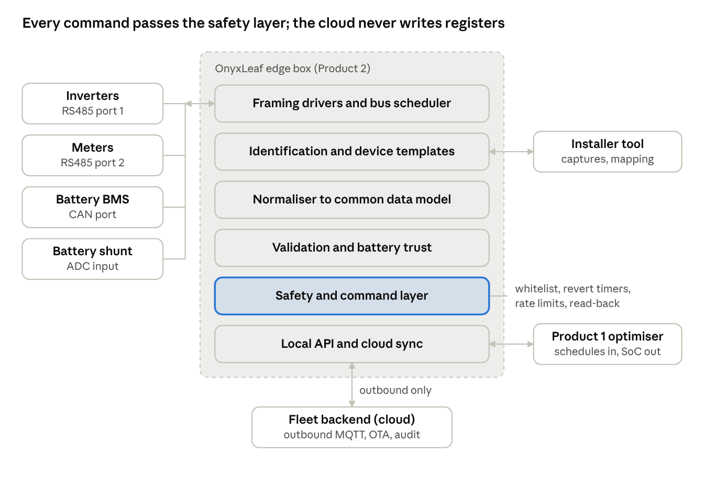

# Product 2: Vendor-Agnostic Inverter and Battery Controller

Oct 30, 2026 · @Onyxleaf Claude AI and Mechanical

## Summary

Build Product 2, but sell it with a published list of 20 to 30 supported device families, not as "works with all systems". Every mature product grows coverage one tested template at a time, and vendor firmware keeps changing the maps ([evcc templates](https://github.com/evcc-io/evcc/tree/master/templates/definition/meter); [deye-inverter-mqtt](https://github.com/kbialek/deye-inverter-mqtt/blob/main/README.md)).

Net billing credits new exports at Rs 8 to 11/kWh while imports cost Rs 37 to 55/kWh ([Dawn](https://www.dawn.com/news/1972203); [NEPRA SRO 1501](<https://nepra.org.pk/tariff/Tariff/Notifications/2026/09%20Sep/SRO%201501(I)-2026%20Dated%2007-09-2026.pdf>)). Battery and export control therefore pays. No local offering found publishes a device list for Chinese hybrids and LFP packs, or a battery state independent of the OEM BMS.

| Finding | Number | What it means for Product 2 |
| --- | --- | --- |
| Every project identifies a device, then loads a hand-written template; none infers the map | evcc 251 meter templates, 134 brands; ha-solarman 30 profiles; SolaX plugin 126 to 130 serial-prefix branches ([evcc](https://github.com/evcc-io/evcc/tree/master/templates/definition/meter); [solax-modbus](https://github.com/wills106/homeassistant-solax-modbus/blob/main/custom_components/solax_modbus/plugin_solax.py)) | "Detect all patterns" means a curated library plus automatic identification |
| Automatic inference of register meaning is weak | Best Modbus field inference F1 about 0.70; building point typing 82 to 92%, 99% only after 100 to 160 labels ([DynPRE](https://www.ndss-symposium.org/wp-content/uploads/2024-83-paper.pdf); [Scrabble](https://doi.org/10.1145/3276774.3276795)) | ML drafts a map for an installer to confirm; it cannot run unattended |
| Firmware routinely changes maps | Deye HV firmware 1098+ changed energy scaling x10; Sungrow ships 1 to 3 updates a year without changelogs ([Deye](https://github.com/kbialek/deye-inverter-mqtt/blob/main/README.md); [Sungrow FAQ](https://github.com/mkaiser/Sungrow-SHx-Inverter-Modbus-Home-Assistant/blob/main/doc/faq.md)) | Templates keyed to firmware, with run-time sanity checks |
| Cheap BMS state of charge (SoC) is unreliable on LFP | 1 mV voltage error is about 5% SoC; a JK BMS read 85% when the pack was empty ([LFP paper](https://arxiv.org/pdf/2410.23646.pdf); [Victron forum](https://community.victronenergy.com/t/soc-inaccurate-over-long-periods-and-slow-discharge-with-jk-bms-b2a8s20p-and-bmv-712/47279)) | An independent shunt (from US$100.30) plus an estimator is the headline feature |
| Local rivals already sell OEM-agnostic gateways | NeoTAQ claims 50+ Pakistani sites and 100 MW+; its sole distributor GFE also sells Elum ([NeoTAQ](https://neotaqsys.com/); [GFE](https://gf-energy.com/blog/neosync-vs-epowercontrol-sd-solar-hybrid-controller-comparison)) | Win on Chinese hybrid coverage, battery trust and price, or partner |
| Careless writes damage devices | About 100,000 EEPROM cycles (community); SMA warns cyclic changes destroy flash ([SolaX docs](https://github.com/wills106/homeassistant-solax-modbus/blob/main/docs/automation-examples.md); [SMA](https://files.sma.de/downloads/SMA-Modbus-general-TI-en-10.pdf)) | Write only whitelisted volatile registers, with rate limits and revert timers |

**Is "works with all systems" achievable?** Not literally. It is achievable as "works with every listed device, and onboards an unlisted one in under an hour with the installer". All surveyed projects rely on curated templates plus identity lookup ([Victron probe.py](https://github.com/victronenergy/dbus-modbus-client/blob/master/probe.py); [evcc detect](https://github.com/evcc-io/evcc/blob/master/cmd/detect/definitions.go)).

**What "detect all patterns and adapt" realistically means.** Four mechanisms, most reliable first:

1. Curated templates: one data file per device family, with firmware variants and a recorded test dump.
2. Deterministic identification: read the SunSpec marker, Modbus device ID or a vendor model register, then pick the template.
3. Plausibility scoring: decode candidate maps read-only, score how sensible values look, and flag silent firmware changes.
4. ML-assisted mapping in an installer tool: capture vendor traffic, run physics checks, compare with a reference meter, then get installer confirmation.

**Hardware box or software on gateways?** Ship the software on an OnyxLeaf box built from an off-the-shelf Linux module (Raspberry Pi CM5 class). It needs two isolated RS485 ports, one isolated CAN port and a shunt input. A 4G router would push safety logic into the cloud, and an ESP32 is too small.

Defer a custom board until 20 to 50 pilot sites have run. Containerise the software so partners' Linux gateways can host it later.

## Refined problem statement

The research narrows "any inverter, battery and meter" to 5 inverter families, 2 meter types and 2 battery protocols for release 1. Everything else goes through guided onboarding.

### What the meeting notes asked, and what changes

| Meeting note | Research finding | Revised wording |
| --- | --- | --- |
| "Works with all systems" | Coverage grows template by template | "Works with every listed device; guided onboarding for the rest" |
| "Detect all patterns and adapt" | Identify-then-template everywhere | "Identifies listed devices; maps unknown ones with installer confirmation" |
| "Sequencing of serial data is specific" | Three things: transport framing, word order per point, block and timing limits per device | All three become fields in a device data file |
| "OEM supplier shows wrong data of battery" | LFP physics plus decoding errors | "Independent battery state with a trust score" |
| "Buy inverter of my company" | OEM tools work best inside one brand, e.g. [Sungrow EMS300CP](https://www.estg.eu/en-gb/p/B0B02247/sungrow-ems300cpcommercial-energy-management-system) | "One controller and one data model across brands" |
| "Controller design OR frontend and backend" | The device layer is defensible; dashboards are crowded | Edge box and installer tool first; thin fleet backend |

### Precise problem statement

Installers in Pakistan build solar-plus-storage sites that mix Chinese inverters (often rebadged), LFP packs and meters. Each vendor exposes data through its own register map, dongle and cloud. No single vendor's tools see a mixed site whole, which pushes owners to "buy our inverter". The OEM BMS also often misreports state of charge.

So no one runs one control policy across a site, export limits are set by hand, and dispatch rests on untrusted battery data. Product 2 reads and safely commands listed devices through one box, normalises them into one data model, and publishes battery state with a confidence. Product 1 (the dispatch optimiser) reads that data and sends setpoints back; Product 2 enforces them safely.

### Scope

| Area | In scope, release 1 | Out of scope, release 1 |
| --- | --- | --- |
| Devices | Hybrid and string inverters, LV LFP BMS, grid and load meters | EV chargers, HVAC, utility plant controllers |
| Protocols | Modbus RTU and TCP, Solarman V5, Voltronic ASCII, Pylontech-style CAN, Pylon RS485 | IEC 61850, DNP3, IEEE 2030.5 (no local rule found requires them) |
| Control | Work mode, battery power or current, export limit, TOU slots, via whitelisted registers | Grid-protection settings, third-party firmware updates, writes to unknown registers |
| Battery | Independent SoC and state of health (SoH); trust score | Replacing or reflashing the BMS |
| Gensets | Read status over Modbus | Start, stop and synchronisation (Elum, ComAp and Enercon own this) |
| Optimisation | Local API for Product 1 setpoints | Forecasting and optimisation |
| Unknown devices | Installer onboarding tool with confirmation | Zero-touch automatic mapping |
| Cloud | Outbound sync, fleet health, installer accounts | Full analytics dashboards |
| Markets | Pakistan pilots; Saudi Arabia after SABER and CST approval | PV mounting structures (on hold) |

### First target segment

Start with commercial and small industrial sites of about 20 kW to 500 kW with PV, an LFP battery and a TOU or net-billing tariff. The size band is a hypothesis for the device census (WP1).

Industrial B-2 TOU runs Rs 35.68 peak against Rs 22.83 off-peak ([IESCO](https://www.iesco.com.pk/tariff-guide)). Diesel genset energy costs about Rs 110 to 142/kWh at Rs 400.67/L ([Daily Pakistan](https://en.dailypakistan.com.pk/29-Oct-2026/new-petrol-diesel-rates-in-pakistan-for-october-30); [Enpower](https://enpower.com.pk/how-to-calculate-diesel-generator-running-costs/)). The large-industrial share of lithium imports rose from 3.2% in 2025 to 13.9% in January to May 2026 ([PSA](https://www.pakistansolarassociation.org/pakistan-lithium-ion-battery-import-market-a-17-month-analysis-jan-2025-may-2026-imports-hit-5-39-gw-as-battery-energy-storage-demand-explodes/)).

Homes come later: a home monitor like SolarAssistant sells for USD 59 to 229 one-off ([SolarAssistant shop](https://solar-assistant.io/shop)). Towers come later: Huawei and Jazz already run an integrated package at 1,000 sites ([DCD](https://www.datacenterdynamics.com/en/news/huawei-and-jazz-complete-deployment-of-solar-systems-across-1000-telco-base-stations-in-pakistan/)). Saudi tariffs are flat and surplus earns 5 halalas/kWh, so Saudi value sits at diesel-heavy sites ([Haala Energy](https://haalaenergy.com/saudi-ci-solar-regulations/)).

### First brands

| Family | Why first | Identification hook |
| --- | --- | --- |
| Sungrow SH hybrid and SG string | Named in the meeting; official map public; has an "external EMS" mode | Device type code, register 5000 |
| Growatt SPH, SPA, MIN/MOD TL-XH, then SPF | Named in the meeting; official 85-page map public | Model at holding 28 |
| Deye platform (Sunsynk and other rebadges) | Deepest open-source coverage; many rebadges | Device type, holding register 0 |
| Huawei SUN2000 and LUNA2000 | Most frequent brand on named Pakistani C&I sites | Modbus device ID (FC 43/14); model at 30000 |
| Voltronic PI30-family off-grid units | Large off-grid base; open ASCII protocol | "QPI" returns the protocol ID |
| Meters: Eastron SDM630, Chint DTSU666 | Common; public maps | Model registers |
| Batteries: Pylontech-style CAN, Pylon RS485; then JK, Seplos | De facto LV protocols | Listen for CAN IDs 0x351 to 0x35E |

Second wave: GoodWe (Nizam, Premier Energy), Solis and Sofar (Fronus shows INVT and SofarSolar certificates), SolaX and SMA ([Nizam](https://nizamenergy.com/); [Fronus](https://fronus.com/)). Fingerprint Inverex, Fronus and Knox units on site; their OEM platforms are unverified.

## Technical background

Most devices on Pakistani sites speak Modbus RTU over 2-wire RS485 at 9600 baud, 8N1 ([solax-modbus baud rates](https://github.com/wills106/homeassistant-solax-modbus/blob/main/docs/baudrates.md)). Voltronic-type off-grid units use a 2400-baud ASCII protocol ([PI30](https://github.com/jblance/mpp-solar/blob/master/docs/protocols/PI30_Communication-Protocol-20150924-Customer.pdf)). The hard parts are bus ownership, register conventions and firmware drift.

### Physical layer and bus access

RS485 Modbus allows one master per bus. A vendor dongle, or the inverter's own meter or BMS link, often blocks a second reader.

- Huawei SDongleA-05 and SDongleA-FE block RS485 access while fitted ([huawei\_solar wiki](https://github.com/wlcrs/huawei_solar/wiki/Connecting-to-the-inverter)).
- Sungrow WiNet-S serves one device and fewer registers than the internal LAN port ([datasheet](https://github.com/bohdan-s/Sungrow-Inverter/blob/main/Datasheets/DS_20210611_WiNet-S_EN.pdf); [mkaiser](https://github.com/mkaiser/Sungrow-SHx-Inverter-Modbus-Home-Assistant/blob/main/doc/help.md)).
- Newer Deye units share one RJ45 between RS485 (pins 1 to 3) and battery CAN (pins 4 and 5) ([kellerza wiring](https://github.com/kellerza/sunsynk/blob/main/www/docs/guide/wiring.md)).
- A DTSU666 on a Sungrow or Huawei meter port must not get a second master ([evcc](https://github.com/evcc-io/evcc/blob/master/templates/definition/meter/sungrow-meter.yaml)).

Workarounds, in order of preference:

1. Use a second port, such as Huawei RS485A1 or the Sungrow internal LAN.
2. Read meter and battery values through the inverter that masters them.
3. Put one proxy on the bus: mbusd turns an RTU bus into one TCP server ([kellerza mbusd](https://github.com/kellerza/sunsynk/blob/main/www/docs/guide/mbusd.md)).
4. Use the dongle's local protocol: Solarman V5 on TCP 8899 carries Modbus without disturbing the cloud ([pysolarmanv5](https://pysolarmanv5.readthedocs.io/en/stable/solarmanv5_protocol.html)).
5. Proxy the Growatt cloud link, as grott does via datalogger registers 17 and 18 ([grott](https://github.com/johanmeijer/grott/blob/master/documentatie/registers.md)).
6. Sniff passively with a high-impedance listener, or replace the dongle.

Use FT232RL USB adaptors and Modbus-aware Ethernet gateways; transparent adaptors cannot route to the right slave ([adaptor list](https://github.com/wills106/homeassistant-solax-modbus/blob/main/docs/compatible-adaptors.md)).

### Modbus quirks that break generalisation

The same quantity differs in 12 ways across vendors, and sometimes across firmware of one vendor. Each must be a per-point or per-device field.

| Quirk | Effect | Vendor examples |
| --- | --- | --- |
| Address base | Off-by-one reads | Sungrow documents are 1-based ([Sungrow V1.1.9](https://github.com/bohdan-s/Sungrow-Inverter/blob/main/Modbus%20Information/TI_20250620_Communication%20Protocol%20of%20Residential%20Hybrid%20Inverter_V1.1.9_EN.pdf)) |
| Function code | FC03 and FC04 hold different data | Solis runtime FC04 33xxx, settings FC03 43xxx; SDM630 FC04 vs DTSU666 FC03 ([mbmd](https://github.com/volkszaehler/mbmd/blob/master/meters/rs485/sdm.go)) |
| 32-bit word order | Silent scrambling | Sungrow U32 low word first; SolaX defaults to little |
| Sign and scale | Plausible wrong numbers | Deye signed power, x0.1 points; one SolaX model off by x10 ([SolaX FAQ](https://github.com/wills106/homeassistant-solax-modbus/blob/main/docs/solax-faq.md)) |
| Sentinels | 0xFFFF read as 6553.5 | Sungrow 0xFFFF and 0x7FFF |
| Timing | Timeouts, lockups | Sungrow 1,000 ms; Growatt 850 ms ([V1.24](https://github.com/johanmeijer/grott/blob/master/documentatie/Growatt-Inverter-Modbus-RTU-Protocol-II-V1-24-English-new.pdf)); Huawei 10 s timeout ([lib](https://github.com/wlcrs/huawei-solar-lib/blob/develop/src/huawei_solar/modbus_client.py)) |
| Registers per read | Failed reads | Growatt 125; Huawei 64; SH5.0RS on WiNet-S 38 ([SunGather](https://github.com/bohdan-s/SunGather/blob/main/SunGather/registers-sungrow.yaml)) |
| Atomic writes | Single writes rejected | Growatt TL-XH 3038 and 3039 in one FC16 ([evcc](https://github.com/evcc-io/evcc/blob/master/templates/definition/meter/growatt-hybrid-tlxh.yaml)) |
| Slave ID | No answer | Huawei 0 or 1; GoodWe 0xF7; Deye resets to 0 after some upgrades ([kellerza](https://github.com/kellerza/sunsynk/blob/main/www/docs/guide/fault-finding.md)) |
| Packed fields | Wrong times and models | Growatt hour and minute in one word; FoxESS two ASCII characters per register |
| Write unlock | Writes ignored | SolaX "Lock State"; Huawei installer login |
| Persistence | EEPROM wear | SolaX 0x612 EEPROM vs 0x669 RAM; Growatt 30215 vs volatile 30216 ([plugin\_growatt](https://github.com/wills106/homeassistant-solax-modbus/blob/main/custom_components/solax_modbus/plugin_growatt.py)) |

### Standards

- SunSpec Modbus is the only open, self-describing map: "SunS" at 40000, 50000 or 0, then models 1, 101/103, 124, 701 to 715 and 802 ([sunspec/models](https://github.com/sunspec/models/tree/master/json)). Western brands use it; evcc's Growatt and GoodWe templates are "manual non-sunspec" ([evcc](https://github.com/evcc-io/evcc/blob/master/templates/definition/meter/growatt-hybrid.yaml)).
- SunSpec carries safe-control primitives: reversion timers in models 704 and 124, a controller heartbeat in 802 ([model 704](https://github.com/sunspec/models/blob/master/json/model_704.json)).
- IEEE 1547-2018 requires a local interface via IEEE 2030.5, IEEE 1815 or SunSpec Modbus ([NRECA slides](<https://www.cooperative.com/programs-services/bts/Documents/Emerging%20Priorities%20for%20Energy%20Research%20Day%20-%20Oct%202018/IEEE%201547-2018%20-%20Vartanian%20(NRECA-APA-ResearchDay-20181031).pdf>)). IEEE 1547.1-2020 defines 47 test areas; CSIP builds on 2030.5 ([QualityLogic](https://www.qualitylogic.com/wp-content/uploads/2021/11/QualityLogic-1547.1-Update-Webinar-Nov-17-2021-.pdf)).
- Pylontech-style LV CAN runs at 500 kbps: 0x351 limits, 0x355 SoC and SoH, 0x356 voltage, current and temperature, 0x359 alarms ([CAN V1.3](https://akkudoktor.net/uploads/short-url/dwFYBPwjnfia9tSuhUopj9uGX2u.pdf)). Most batteries on Deye's list use CAN; about 10 use RS485 ([Sunsynk list](https://portal.segen.co.uk/reseller/docs/Sunsynk_BatteryCompatibility_v14_English.pdf)).
- Voltronic PI30 commands include QPI, QPIGS, POP (output priority), PCP (charger priority) and PSAVE ([pi30.py](https://github.com/jblance/mpp-solar/blob/master/mppsolar/protocols/pi30.py)). IEC 61850-7-420 was not verified.

### Per-vendor register maps

Register numbers follow each vendor's document; treat them as pointers for template authors.

| Vendor | Protocol | Map availability | Key reads | Key writes | Quirks |
| --- | --- | --- | --- | --- | --- |
| Sungrow SH hybrid | RTU 9600, ID 1; TCP 502 on LAN | [V1.1.9](https://github.com/bohdan-s/Sungrow-Inverter/blob/main/Modbus%20Information/TI_20250620_Communication%20Protocol%20of%20Residential%20Hybrid%20Inverter_V1.1.9_EN.pdf), marked not for redistribution | 5000 type; 5214-15 battery W; 5601 meter W; 13008 load | 13050 EMS mode (3 = external); 13051 command; 13052 power; 13074 and 13087-88 feed-in limit | 1-based; 1 s period |
| Sungrow SG string | As above | [V1.1.53](https://github.com/bohdan-s/Sungrow-Inverter/blob/main/Modbus%20Information/TI_20230117_Communication.Protocol.of.Residential.and.Commerical.PV.Grid-connected.Inverter_V1.1.53_EN.pdf) | 5000 type | 5006 start/stop; 5007-08 power limit; 5010-11 export limit | Export limit on some models only |
| Growatt | RTU 9600 or 38400 | [V1.24](https://github.com/johanmeijer/grott/blob/master/documentatie/Growatt-Inverter-Modbus-RTU-Protocol-II-V1-24-English-new.pdf) | Windows differ by family | 122-123 export limit; 1044 priority; 1090-92 charge; 1100-08 slots | Packed times; FC16 groups |
| Huawei | TCP 502 or 6607; RTU RS485A1 | [huawei-solar-lib](https://github.com/wlcrs/huawei-solar-lib/blob/develop/src/huawei_solar/registers.py) (AGPL) | 30000 model; 32080 W | 47247/47249 forced power; 47416 feed-in limit | Installer login; slow dongle |
| Deye and rebadges | RTU on RJ45; V5 on TCP 8899 | V118 cited in [ha-solarman](https://github.com/davidrapan/ha-solarman/blob/main/custom_components/solarman/inverter_definitions/deye_hybrid.yaml) | 0 type; 183 battery V; 190 battery W | 243-248 priority, load limit, max sell; 250-255 slots ([sunsynk](https://github.com/kellerza/sunsynk/blob/main/src/sunsynk/definitions/single_phase.py)) | 3-phase uses other addresses |
| Solis | RTU; V5 | Ver3.2 cited in [solis\_modbus](https://github.com/Pho3niX90/solis_modbus/blob/master/custom_components/solis_modbus/helpers.py) | 35000 or 3041 model | 43110 storage switch; volatile dispatch | Dispatch needs firmware flag |
| GoodWe | UDP 8899 AA55; TCP 502 | [goodwe](https://github.com/marcelblijleven/goodwe/blob/master/goodwe/et.py) library | Discovery reply | 47509-10 export limit; 47511 EMS mode | Firmware-gated blocks |
| SolaX | RTU 9600 to 115200 | [solax-modbus](https://github.com/wills106/homeassistant-solax-modbus/blob/main/custom_components/solax_modbus/plugin_solax.py) | Serial prefix | Remote control at 0x7C (volatile) | Unlock first |
| Victron GX | TCP | [attributes.csv](https://github.com/victronenergy/dbus_modbustcp/blob/master/attributes.csv) | 843 SoC | 2700 AC setpoint; 2902 mode | Unit ID 100 |
| Voltronic PI30 | ASCII 2400 | [PI30 PDF](https://github.com/jblance/mpp-solar/blob/master/docs/protocols/PI30_Communication-Protocol-20150924-Customer.pdf) | QPIGS, QMOD | POP, PCP, MCHGC | PSAVE writes EEPROM |

| Meter or battery | Protocol | Key points | Quirk |
| --- | --- | --- | --- |
| Eastron SDM630 | RTU FC04 floats | Total power 0x0034 ([mbmd](https://github.com/volkszaehler/mbmd/blob/master/meters/rs485/sdm.go)) | Variants differ |
| Chint DTSU666 | RTU FC03 floats | Power 0x2012; Sungrow variant ID 254, type 0x20D5 ([Sungrow DTSU666](https://github.com/bohdan-s/Sungrow-Inverter/blob/main/Modbus%20Information/DTSU666%20Meter%20Communication%20Protocol_20210601.pdf)) | Firmware variants per inverter brand |
| Pylontech-style CAN | 500 kbps | 0x351 to 0x35E; inverter answers 0x305 | Groups offset 0x1000 |
| Pylon RS485 | ASCII | V3.3 spec in [python-pylontech](https://github.com/Frankkkkk/python-pylontech) | Differs from CAN path |

## Pakistan brand mix and local players

No brand-level market share data was found; what is known comes from distributor line-ups, retail listings and about 10 named C&I sites. A device census through installers is therefore the first work package.

### What is known and not known

- Distributors: Premier Energy carries GoodWe, Huawei, Infini and Tranergy; Nizam carries GoodWe, SAJ and TBB ([Premier](https://www.premierenergy.com.pk/list-of-solar-energy-companies-in-pakistan/); [Nizam](https://nizamenergy.com/)).
- Named C&I sites run Huawei, SMA and Sungrow; GIKI runs 20 multi-brand inverters ([GFE](https://gf-energy.com/solutions/automation/solar-diesel-controller); [NeoTAQ case](https://neotaqsys.com/case-studies/industrial-rice-mill)).
- Retail LFP medians (Rs/kWh, Oct 2026): Sunwoda 44,800, Inverex 55,900, Dyness 56,000, Pylontech 67,200 ([SolarCitizen](https://www.solarcitizen.com.pk/lithium-battery-price-pakistan/)).
- Scale: off-grid solar exceeds 13,000 MW ([Dawn](https://www.dawn.com/news/1972203)); 2025 lithium imports were 4.6 GWh, or 3.31 GWh by customs data ([ESS News](https://www.ess-news.com/2026/07/15/pakistan-imports-4-6-gwh-of-bess-in-2025/)).
- Unknown: brand shares by segment, and the OEM behind Inverex, Knox, Itel and Tesla Industries units.

### Rebadges and OEMs

- Fronus shows OEM certificates from INVT and SofarSolar, and signed a 100 MW deal with SolaX in 2022 ([Fronus](https://fronus.com/); [SolaX](https://za.solaxpower.com/news/solax-signed-a-100mw-strategic-cooperation-agreement-with-fronus.html)).
- Inverex sells NitroX hybrids and its own 51.2 V packs ([Inverex](https://www.inverex.com.pk/)). A "-5G" NitroX suffix matches Solis naming; unverified.
- Voltronic is reported as OEM for MPP Solar, Axpert and others (forum, 2017) ([powerforum](https://powerforum.co.za/topic/1306-inverters-what-is-the-original-and-what-is-the-copy/)).
- No Pakistani rebadge name appears in the open-source brand lists checked. Inference: most rebadges match an existing platform map, so platform identification matters more than brand names.

### Local players

| Player | What it does | Scale claimed | Role for Product 2 |
| --- | --- | --- | --- |
| Enercon Systems Intl, Karachi (likely "EnerCon") | Microgrid controls on Siemens PLC; genset sync; SCADA; cloud dashboard ([Enercon](https://enerconsys.com/services/microgrid-controls/)) | IPAK (5 gensets, 16 inverters); Lucky Energy 72 MW; markets KSA | Competitor at large microgrids; possible buyer of a driver or battery-trust module |
| Green Fuel Energy, Lahore (likely "Greenfuels") | EPC; sole Pakistan distributor of NeoTAQ; distributes Elum ([GFE](https://gf-energy.com/)) | 250+ projects, 100 MW+; supplies other EPCs | Channel tied to rivals; proves EPCs resell third-party controllers |
| NeoTAQ Systems, Masdar City (Pakistani team) | neoCore OEM-agnostic gateway (RS485, Modbus, OPC-UA, 4G); BESS and hybrid dispatch; cloud ([NeoTAQ](https://neotaqsys.com/)) | 50+ PK sites; 100 MW+; KSA show 23 to 25 Nov 2026 | Closest competitor; no device list or battery trust published |
| SkyElectric, Islamabad | Own inverter and battery; SmartFlow AI; NOC ([SkyElectric](https://www.skyelectric.com/)) | 10,000+ systems; 250+ installers | Closed ecosystem; competitor in homes and SMEs |
| Reon Energy | SPARK telecom EMS; REFLEX BESS ([Reon](https://reonenergy.com/)) | 5,500 towers; KSA licence | Telecom incumbent; phase 2 |
| Enerlytics Lab, Karachi | Cloud monitoring; "device agnostic" with no list; no control shown ([Enerlytics](https://enerlyticslab.com/)) | Small team; KSA distributor | Possible dashboard partner |

**"NeoSat Renewable" was not found.** Searches returned only Neosat satellite receivers ([OLX](https://www.olx.com.pk/items/q-neosat)). The likeliest match is NeoTAQ, GFE's controller partner; the engineering manager should confirm.

Inference: the three names form two controller ecosystems, Enercon and GFE plus NeoTAQ. Treat both first as competitors to learn from, then as possible component buyers.

## Who else is doing this

At least 14 commercial products read and control multi-brand devices, but none found sells to Pakistan's hybrid segment through local installers. SolarAssistant is closest in price and brand mix, but its shop does not ship to Pakistan, Saudi Arabia or the UAE ([shop](https://solar-assistant.io/shop)).

| Player | Device library | How added | Control | Pricing (date) | Customers | PK or KSA | Link |
| --- | --- | --- | --- | --- | --- | --- | --- |
| Solar-Log Base | 130 to 180 makers (page conflicts) | Vendor drivers via firmware | Feed-in rules; 100 devices | Per-function licences | 260,000 plants (2017-18 headline) | None found | [Solar-Log](https://www.solar-log.com/en/support/component-database) |
| meteocontrol blue'Log | 30 to 100 devices | Vendor list | XC: P and Q control | By plant kW | C&I to utility | None found | [datasheet](https://www.meteocontrol.com/fileadmin/Daten/Dokumente/EN/Produkte/On_Site/blue_Log_XM_XC/Data_sheet/DB_blueLog_XM_XC_en_2025-12-17.pdf) |
| Eniris SmartgridOne | About 115 inverter brands | Vendor | Zero export; 600 s fallback | SMA API fees passed on | Belgium | None found | [Eniris](https://docs.eniris.com/en/Controller/Devices/PV-hybrid-and-battery-inverters/SMA/API) |
| SMA Data Manager M | 50 devices; SunSpec third parties | SunSpec | P and Q control | Not found | OEM | Not found | [SMA](https://files.sma.de/downloads/EDMM-20-DS-en-11.pdf) |
| Huawei SmartLogger3000 | 80 devices | Huawei | Zero export | Not found | C&I BESS bundles | KSA marketing (headline) | [datasheet](https://gbc-solino.cz/wp-content/uploads/2024/04/DS_HUAWEI_SMARTLOGGER_3000A01-A03-EN.pdf) |
| Sungrow Logger1000 | 30 devices | Sungrow | Power control, firmware | Not found | OEM | PK distribution 2021 (headline) | [Sungrow](https://www.sungrowpower.com/en/products/Intelligent-Gateway/MonitoringLogger1000) |
| Solarman Business | Own loggers, "third-party inverters" | ODM supplier | "Control" claimed | Quote | 1.5M+ users | Sticks common (inference) | [Solarman](https://www.solarmanpv.com/products/solarman-business) |
| Elum ePowerControl | "95% of the market" | Vendor | Genset load, zero export, peak shaving | Quote | PK chemical factory, 200 kWp | Via GFE | [Elum](https://elum-energy.com/solar-diesel-hybrid-controller/) |
| ComAp InteliNeo | Gensets via Modbus; Fronius via SunSpec | Paid SKU | PV, BESS, genset | Feature SKUs | Microgrids | Not found | [ComAp](https://na.comap-control.com/insights/intelineo-6000-and-5500-support-any-gen-set-controls/) |
| Victron Cerbo GX | 4 PV brands; 7 genset brands; community drivers | Vendor and community | Zero feed-in with 2 brands | Not found | Large community | Not found | [Victron](https://www.victronenergy.nl/media/pg/Cerbo_GX/en/connecting-supported-non-victron-products.html) |
| SolarAssistant | 16 inverter brands, 18 BMS | Vendor | Remote settings | USD 59 software; USD 179 to 229 kits (30 Oct 2026) | South African community | No shipping | [SolarAssistant](https://solar-assistant.io) |
| gridX | 55+ OEMs, 500+ devices | OEM certification | HEMS | Not found | 250k+ assets | None found | [gridX](https://gridx.ai/press-releases/solax-is-new-ready-for-gridx-partner) |
| Smartfox Pro 2 | Modbus, RS485, S0 | Vendor | Surplus control | EUR 1,130.08 incl. VAT, 10 years monitoring (30 Oct 2026) | Europe | None found | [Galaxus](https://www.galaxus.at/en/s1/product/dafi-smartfox-pro-2-80a-relays-22946236) |
| NeoTAQ neoCore | "OEM-agnostic"; no list | Not stated | Rule-based, BESS, genset | Not public | 50+ PK sites | PK via GFE; KSA show | [NeoTAQ](https://neotaqsys.com/) |

### Business-model lessons

- Four pricing models exist: per-function licences (Solar-Log), one-off software (SolarAssistant), hardware with bundled monitoring (Smartfox), and white-label OEM deals (gridX).
- SolarAssistant tried paid updates in 2024 at USD 14 a year, then made updates free ([terms](https://solar-assistant.io/help/updates/terms_update_oct_2024)). Inference: prefer an installer fleet tier over end-customer subscriptions.
- "Ready for gridX" OEM certification claims 75% fewer support tickets ([gridX](https://gridx.ai/press-releases/solax-is-new-ready-for-gridx-partner)). Pakistani distributors of Chinese brands could play that role.
- Coverage is a moat kept by a vendor driver team ([Solar-Log](https://www.solar-log.com/en/support/component-database)); a tested data-file library can grow faster.

### Liability handling

- Disclaimers: Solar-Log's database says "All information without guarantee!"
- Fail-safe defaults: Eniris reverts to a preset within 600 s of link loss.
- Warranty friction: some setups need automatic updates disabled, which "manufacturers often don't approve" ([Memodo](https://www.memodo.de/media/pdf/a3/5b/5f/Memodo-Energy-Management-Systems-2024.pdf)).
- No vendor warranty statement on third-party Modbus writes was found.

## Open-source codebases

About 40 projects cover roughly 160 inverter, meter and storage brands, but no brand list checked names a Pakistani rebadge. Stars were read from GitHub pages on 30 and 31 October 2026; last commits come from clones on 30 October 2026.

| Repo | Licence | Stars | Last commit | Brands | Format | Auto-detection | Writes | Reuse verdict |
| --- | --- | --- | --- | --- | --- | --- | --- | --- |
| [ha-solarman](https://github.com/davidrapan/ha-solarman) | MIT | 516 | 2026-05-03 | Deye, Sofar, Solis, SRNE, Kstar and more (30 profiles) | YAML | Deye register 0 | Yes | Schema base and data, with notices |
| [evcc](https://github.com/evcc-io/evcc) | MIT, except sponsor parts | 7.5k | 2026-10-30 | 134 meter brands | Templated YAML | Network hints; SunSpec probe | Yes, sequences | Copy template design |
| [solax-modbus](https://github.com/wills106/homeassistant-solax-modbus) | Apache-2.0 | 528 | 2026-10-28 | SolaX, Growatt, Sofar, Solis, SRNE | Python dataclasses | Serial prefix | Yes | Facts and quirks |
| [goodwe](https://github.com/marcelblijleven/goodwe) | MIT | 179 | 2026-03-29 | GoodWe | Python classes | UDP discovery, try families | Yes | Reuse |
| [SunGather](https://github.com/bohdan-s/SunGather) | GPL-3.0 | 214 | 2026-10-24 | Sungrow (92 codes) | YAML | Register 5000 | Not reviewed | Reference only |
| [mkaiser Sungrow](https://github.com/mkaiser/Sungrow-SHx-Inverter-Modbus-Home-Assistant) | MIT | 708 | 2026-09-06 | Sungrow SH | HA YAML | Register 5000 | Yes | Reuse facts |
| [grott](https://github.com/johanmeijer/grott) | None | 534 | 2025-05-26 | Growatt cloud protocol | JSON offsets | Frame header | Yes | Facts only |
| [sunsynk](https://github.com/kellerza/sunsynk) | Apache-2.0 | 340 | 2026-10-24 | Deye, Sunsynk | Python tables | Registers 0 to 7 | Yes | Reuse |
| [huawei-solar-lib](https://github.com/wlcrs/huawei-solar-lib) | AGPL-3.0 | 48 | 2026-08-21 | Huawei | Python dict | FC 43/14 | Yes | Reference only |
| [pysunspec2](https://github.com/sunspec/pysunspec2), [models](https://github.com/sunspec/models) | Apache-2.0 | 74, 131 | 2026-10-21, 2026-08-20 | Any SunSpec device | JSON | "SunS" marker | Yes | Adopt for naming |
| [PythonProtocolGateway](https://github.com/HotNoob/PythonProtocolGateway) | Apache-2.0 | 65 | 2025-08-12 | Growatt, EG4, SRNE, Pylon (48 maps) | CSV | Plausibility scoring | Partial | Reuse CSVs, scoring idea |
| [dbus-serialbattery](https://github.com/Louisvdw/dbus-serialbattery) | MIT (archived); [fork](https://github.com/mr-manuel/venus-os_dbus-serialbattery) AGPL since 2024-12-06 | 591, 276 | 2026-06-25, 2026-09-29 | 20+ BMS brands | Python classes | Ordered driver list | Sends limits to Victron | MIT era only |
| [Battery-Emulator](https://github.com/dalathegreat/Battery-Emulator) | GPL-3.0 | 3.0k | 2026-10-29 | 57 batteries, 24 inverter protocols | C++ | User selects | Emulates battery | Reference only |
| [dbus-modbus-client](https://github.com/victronenergy/dbus-modbus-client) | None shown | 33 | 2026-07-10 | Meters, gensets | Python handlers | Model-register probe | Not reviewed | Pattern only |
| [OpenEMS](https://github.com/OpenEMS/openems) | EPL-2.0; UI AGPL-3.0 | 1.6k | 2026-10-30 | 211 bundles | Java | Configured | Yes | Data model ideas |
| [mpp-solar](https://github.com/jblance/mpp-solar) | MIT | 438 | 2026-04-12 | Voltronic PI16 to PI41, JK, Daly | Command dicts | QPI | 26 setters | Reuse |
| [pysolarmanv5](https://github.com/jmccrohan/pysolarmanv5) | MIT | 180 | 2026-03-08 | Any Solarman-logged inverter | Transport | Scan utility | Via Modbus | Reuse |
| [foxess\_modbus](https://github.com/nathanmarlor/foxess_modbus) | MIT | 333 | 2026-06-24 | FoxESS, rebadges | Python | Model regex plus firmware | Yes | Firmware pattern |
| [esphome-smg-ii](https://github.com/syssi/esphome-smg-ii) | Apache-2.0 | 165 | 2026-10-28 | SMG-II clones, PowMr, Anenji | YAML | User selects | Not reviewed | Reuse YAML |

pymodbus (BSD-3-Clause, 2.8k stars) suits host-side test harnesses ([pymodbus](https://github.com/pymodbus-dev/pymodbus)).

### What the important repos teach

- **ha-solarman:** each `inverter_definitions/*.yaml` item has `rule`, `registers`, `scale`, `lookup`, `validation` and `configurable` ([deye\_hybrid.yaml](https://github.com/davidrapan/ha-solarman/blob/main/custom_components/solarman/inverter_definitions/deye_hybrid.yaml)). It ships no tests.
- **evcc:** `templates/definition/meter/sungrow-hybrid.yaml` adds aliases, firmware requirements, discovery hints and a write `sequence` ([file](https://github.com/evcc-io/evcc/blob/master/templates/definition/meter/sungrow-hybrid.yaml)). `cmd/detect/definitions.go` scans ports 502 and 1502, then probes SunSpec models on common unit IDs ([file](https://github.com/evcc-io/evcc/blob/master/cmd/detect/definitions.go)).
- **solax-modbus:** `const.py` defines scan groups, sleep modes and protocol-version gates ([const.py](https://github.com/wills106/homeassistant-solax-modbus/blob/main/custom_components/solax_modbus/const.py)).
- **goodwe:** `goodwe/__init__.py` matches serial tags, then tries each family in turn ([file](https://github.com/marcelblijleven/goodwe/blob/master/goodwe/__init__.py)).
- **SunGather:** `registers-sungrow.yaml` filters registers by model and splits reads around a WiNet-S bug ([file](https://github.com/bohdan-s/SunGather/blob/main/SunGather/registers-sungrow.yaml)).
- **grott:** `grottdata.py` XOR-decodes Growatt frames with the mask "Growatt" ([file](https://github.com/johanmeijer/grott/blob/master/grottdata.py)).
- **sunsynk:** `src/sunsynk/identity.py` maps register 0 to a family; `www/docs/guide/` documents wiring and failures ([file](https://github.com/kellerza/sunsynk/blob/main/src/sunsynk/identity.py)).
- **huawei-solar-lib:** `device_discovery.py` uses FC 43/14, including private object 0x87 ([file](https://github.com/wlcrs/huawei-solar-lib/blob/develop/src/huawei_solar/device_discovery.py)).
- **pysunspec2:** `sunspec2/modbus/client.py` tries 40000, 0 and 50000, then walks the model chain ([file](https://github.com/sunspec/pysunspec2/blob/master/sunspec2/modbus/client.py)).
- **PythonProtocolGateway:** its `analyze_protocol` routine in `classes/transports/modbus_base.py` scores every candidate map by value plausibility ([file](https://github.com/HotNoob/PythonProtocolGateway/blob/main/classes/transports/modbus_base.py)).
- **dbus-serialbattery:** caches the last good driver and runs a full scan only after 3 failures ([file](https://github.com/mr-manuel/venus-os_dbus-serialbattery/blob/master/dbus-serialbattery/dbus-serialbattery.py)).
- **Battery-Emulator:** `test/` replays recorded CAN logs, a pattern worth copying ([repo](https://github.com/dalathegreat/Battery-Emulator/tree/main/test)).
- **Victron:** `probe.py` reads one model register per handler; `scan.py` locks baud, then scans IDs ([scan.py](https://github.com/victronenergy/dbus-modbus-client/blob/master/scan.py)).
- **OpenEMS:** shared "Nature" channels fix signs: battery charge negative, grid import positive ([SymmetricEss.java](https://github.com/OpenEMS/openems/blob/develop/io.openems.edge.ess.api/src/io/openems/edge/ess/api/SymmetricEss.java)).
- **mpp-solar:** `mppsolar/protocols/pi30.py` defines Voltronic queries and setters ([file](https://github.com/jblance/mpp-solar/blob/master/mppsolar/protocols/pi30.py)).
- **pysolarmanv5:** ships `solarman-tcp-proxy` and `solarman-rtu-proxy`, which let standard Modbus tools talk through a logger and log every transaction ([utilities](https://github.com/jmccrohan/pysolarmanv5/blob/main/docs/utilities.rst)).

### Licence rules and a clean-room path

- MIT, Apache-2.0 and BSD data or code may enter a closed product if notices are kept.
- GPL and AGPL code may not; AGPL also reaches a hosted portal. Use these repos for facts only.
- EPL-2.0 is file-level: modified OpenEMS files must be published.
- No licence means all rights reserved; evcc's sponsor parts are excluded from MIT ([exclusions.md](https://github.com/evcc-io/evcc/blob/master/LICENSES/exclusions.md)).
- Sungrow's PDF forbids redistribution, so ship derived tables, not the PDF.

Clean-room steps (legal points need counsel):

1. Team A reads copyleft code and writes a neutral spec per family from vendor PDFs and captures, with no code.
2. Team B, which has not read that code, writes plugins and data files from the spec.
3. Each data file keeps a provenance log: source document, capture IDs, author, licence.
4. Bootstrap from ha-solarman and PythonProtocolGateway with a converter, then re-verify against PDFs and captures.

## Methods to generalise

A ten-layer method gets as close to "detect all patterns" as the evidence allows. Templates and identification do most of the work; inference narrows the rest for a human to confirm.

The meeting's "each company has its own pattern" is not Modbus framing, which is public. It is the register map, the identity convention and the timing rules.

| Layer | What it does | Evidence | Expected accuracy |
| --- | --- | --- | --- |
| 0. Transport discovery | Common baud and IDs first, lock baud, then scan IDs; TCP 502, 1502, 6607, 8899 | Victron two-stage scan ([scan.py](https://github.com/victronenergy/dbus-modbus-client/blob/master/scan.py)) | Nearly all wired devices (estimate); brute force over 6 bauds, 3 parities and 247 IDs takes 7 to 8 minutes |
| 1. Identification | SunSpec marker, FC 43/14, model register, serial prefix, QPI, firmware read | pysunspec2, huawei-solar-lib, ha-solarman | Near-certain for templated families (estimate) |
| 2. Templates | Data file per family, firmware variants, golden test | evcc, ha-solarman | As good as its dumps |
| 3. Plausibility scoring | Decode candidate maps read-only and score them | [PythonProtocolGateway](https://github.com/HotNoob/PythonProtocolGateway/blob/main/classes/transports/modbus_base.py) | Unmeasured; good among sibling maps |
| 4. Passive capture | Log the vendor dongle's polls and writes | [pysolarmanv5 proxies](https://github.com/jmccrohan/pysolarmanv5/blob/main/docs/utilities.rst); [sunsniff](https://docs.rs/crate/sunsniff/0.4.2/source/README.md) | Finds live registers, not meaning |
| 5. Type and scale guesses | Try 16 and 32-bit, both word orders, float, ASCII; anchor scale on 50 Hz, 230 V, 51.2 V | Proposed | Hypothesis |
| 6. Physics checks | P about V × I within 5%; power balance; energy equals integrated power; SoC trend matches battery sign | Proposed | Hypothesis: high on critical points |
| 7. Reference correlation | Clip a known meter at the grid point and cross-correlate | Proposed | Grid register, sign and scale within minutes (estimate) |
| 8. Whitelisted probing | Small safe change, then diff registers; never blind writes | [DynPRE](https://www.ndss-symposium.org/wp-content/uploads/2024-83-paper.pdf); [SePanner](https://doi.org/10.1145/3627106.3627179) | Finds writable setpoints |
| 9. LLM drafting from PDFs | Strict JSON, lint, live validation, human sign-off | [Nunes et al.](https://aclanthology.org/2025.xllm-1.2.pdf) | Drafting aid; never auto-enables writes |

Layers 0 to 3 run on the edge; 4 to 8 run in the installer tool; 9 runs in the back office. The installer confirms 10 to 30 control-critical points before any write.

### Research literature

| Line of work | Result | Meaning for Product 2 |
| --- | --- | --- |
| Passive reverse engineering: BinaryInferno, NDSS 2023 | On Modbus, precision 1.00 but recall 0.40 with priors ([paper](https://www.ndss-symposium.org/wp-content/uploads/2023-131-paper.pdf)) | Finds field boundaries, not meaning |
| Active reverse engineering: DynPRE, NDSS 2024 | Modbus F1 0.70, perfection 0.49 vs 0.09 to 0.28 passive | Probing a live device beats statistics |
| ICS semantics: ACSAC 2014, SePanner 2023, PVParser 2026 | Process variables from traffic and multi-state diffs ([2014](https://doi.org/10.1145/2664243.2664277); [PVParser](https://arxiv.org/abs/2608.16403)) | Closest analogues; none tested on inverters |
| Building metadata: Hong et al. 2015 | Over 92% within, over 82% across buildings ([arXiv](https://arxiv.org/abs/1509.00498)) | Behaviour-based typing near 80 to 90% (estimate) |
| Active learning: Scrabble 2018 | 83.2% with 10 labels; 99% with 100 to 160 | Human labels close the gap |
| LLM table extraction: Nunes 2025 | GPT-4o 89.6% GriTS F1 on simple tables; 5.2% extra rows | Real manuals are harder |

No paper was found that infers inverter or BMS register meaning ([ICS survey 2025](https://sands.edpsciences.org/articles/sands/full_html/2025/01/sands20250012/sands20250012.html)). Honest expectations: near-certain identification for templated families; about 80 to 90% typing for unknown devices, raised on critical points by physics checks. Claim "auto-configure" only for listed devices, and "guided onboarding in under an hour" for the rest.

Each confirmed mapping becomes a template and labelled data, so later units of the same platform need fewer labels.

### Device-definition schema sketch

| Block | Fields | Borrowed from |
| --- | --- | --- |
| Identity | schema version, id, product aliases incl. rebadges, category | evcc `products` |
| Transport | kind (RTU, TCP, V5, Voltronic, CAN, Pylon RS485), baud list, parity, unit IDs, max read, barriers, turnaround, timeout | Victron, ha-solarman |
| Identify | probes: function code, address, type, words, match (set, regex, prefix), capture as serial or firmware | Victron `ModelRegister` |
| Variants | firmware or protocol ranges with overrides | foxess, solax |
| Points | key, function code, address, address base, type, word order, scale or scale register, unit, sign, sentinels, lookup, range, poll class, canonical name | ha-solarman, evcc, SunSpec |
| Writes | function code, min, max, step, persistence class, atomic group, unlock, revert register, rate limit | SunSpec, Growatt, SolaX |
| Commands | intents mapped to write sequences: set mode, battery power, export limit, TOU slot, release | evcc `sequence` |
| Requirements | minimum firmware, dongle, port | evcc |
| Tests | golden dump, expected values, source document, capture IDs, licence | Battery-Emulator |

### Common data model

| Domain | Points | Sign convention |
| --- | --- | --- |
| Grid | P per phase and total, Q, V, f, import and export energy | Import positive |
| PV | P per MPPT and total, energy | Production positive |
| Battery | P, V, I, BMS SoC, OnyxLeaf SoC with uncertainty, SoH, temperatures, cell extremes, limits, capacity | Charge negative |
| Load | P, energy | Consumption positive |
| Inverter | status, alarms, rated power, mode | None |
| Controls | mode, battery setpoint, export limit, TOU slots, reserve SoC, release | None |
| Meta | identity, firmware, template ID, quality flags, trust score | None |

Names follow SunSpec; signs follow OpenEMS ([ElectricityMeter](https://github.com/OpenEMS/openems/blob/develop/io.openems.edge.meter.api/src/io/openems/edge/meter/api/ElectricityMeter.java)). This set is the overlap of evcc, OpenEMS and SunSpec, and the physics checks can verify all of it ([evcc api.go](https://github.com/evcc-io/evcc/blob/master/api/api.go)).

## Trusting battery data

On LFP, 1 mV of open-circuit voltage (OCV) error can mean about 5% SoC error ([Paizulamu et al. 2024](https://arxiv.org/pdf/2410.23646.pdf)). A cheap BMS's SoC is therefore a noisy guess, and the meeting's complaint need not mean bad faith.

### Why OEM SoC is wrong on LFP

- Temperature: at one OCV, SoC differs by 12.89 points between 50 and 25 °C, and 17.42 points between 25 and −10 °C (same paper).
- Low-current blindness: a JK unit erred up to 50% below 1 A; 250 mA unmeasured for 7 days is 42 Ah ([Victron forum](https://community.victronenergy.com/t/soc-inaccurate-over-long-periods-and-slow-discharge-with-jk-bms-b2a8s20p-and-bmv-712/47279)).
- Field case: at cutoff, a JK BMS showed 85% and a BMV-712 shunt 57%; the 230 Ah pack was empty (same thread).
- Another case: BMS at 87% while voltage suggested about 61% ([Power Forum](https://powerforum.co.za/topic/28446-bms-why-i-dont-trust-soc-reading-yet/)).
- Rare resets: SoC is usually corrected only at full charge (same sources).

Decoding errors can also produce wrong battery data: untreated 0xFFFF sentinels, wrong sign or x10 scale. Test this hypothesis on the units the manager saw. Inference: hot sites that rarely reach 100% reset rarely, so drift builds for days or weeks.

### Independent sensing options

| Option | Accuracy | Cost (date) |
| --- | --- | --- |
| Victron SmartShunt 500 A | Current 0.4%, 0.01 A resolution, offset under 20 mA ([datasheet](https://cdn.shopify.com/s/files/1/0742/9278/9544/files/Datasheet-SmartShunt-IP65-EN.pdf)) | US$100.30, AgileOffroad, 30 Oct 2026 ([listing](https://agileoffroad.com/products/victron-energy-smartshunt-500a-all-in-one-battery-monitor)); no Pakistani price found |
| Custom shunt with isolated ADC (INA228 class) | Not sourced | Not sourced; likely cheaper at volume (inference) |
| Clamp-on DC Hall CT | Drifts at low current (forum claim) | Not sourced; not for coulomb counting |
| BMS cell voltages over RS485 or CAN | Not quantified | No extra cost |
| Own pack voltage, 2 to 4 NTC probes, listen-only CAN | Not quantified | Low |

### Estimation methods

| Method | Reported accuracy | Limit |
| --- | --- | --- |
| Adaptive multi-model EKF ([2024](https://arxiv.org/pdf/2410.23646.pdf)) | SoC RMSE 2.97% at −10 °C vs 13.05% for a UKF | Lab LFP cells |
| ICA for SoH ([2018](https://research.chalmers.se/en/publication/503805)) | Under 2.5% error | NASA cells, not LFP |
| Physics-informed network for SoH ([2024](https://doaj.org/article/d3434fee2299421781688f321c8b86b4)) | MAPE 0.87% on 387 batteries | LFP share unclear |
| BatteryML benchmark ([2023](https://arxiv.org/html/2310.14714v5)) | Linear model error 90 cycles vs LSTM 11,911 | Simple models win on small data |

### Recommended approach

1. Measure shunt current, pack voltage and temperature; treat BMS SoC and cell data as extra noisy inputs.
2. Run a 1-RC or 2-RC circuit model with temperature-indexed OCV and hysteresis in an EKF at 1 Hz.
3. Reset at anchors: full charge, the low-voltage knee, and long rests below 20% or above 90%. Widen uncertainty on the 30 to 80% plateau.
4. Track SoH from amp-hours between anchors, ICA peaks on slow charges, and resistance from current steps.
5. Compute a trust score from the gap between BMS SoC and the estimate; flag gaps above, say, 10 points.
6. Publish SoC with its uncertainty so Product 1 can hold a margin.

Expect about 3 to 8% field SoC error between resets; this is an inference to validate.

### Datasets and limits

BatteryML unifies MATR (180 LFP cells), HUST (77 LFP) and others ([BatteryML](https://github.com/microsoft/BatteryML)); PyBaMM can generate synthetic LFP data ([PyBaMM](https://github.com/pybamm-team/PyBaMM)). No public dataset covers hot-climate stationary packs read through a cheap BMS. Logging 1 Hz data from the first 20 to 50 pilot sites matters more.

## Controller hardware and software architecture

A Linux module with two isolated RS485 ports, one isolated CAN port and a shunt input covers every interface found. A prototype costs an estimated US$120 to 200. Prices were retrieved on 30 October 2026 unless stated.

Telemetry flows down the stack to the local API; commands from Product 1 or the fleet enter at the API and reach a device only through the safety layer.

### Hardware options

| Option | Price (source) | Isolation | Fit |
| --- | --- | --- | --- |
| LilyGO T-CAN485, ESP32 with RS485 and CAN | US$11.43, Dec 2021 ([CNX](https://www.cnx-software.com/2021/12/20/ttgo-t-can485-an-esp32-board-with-rs485-can-bus-interfaces/)) | Not stated | Bridge only |
| Pi 5 or CM5 with Waveshare Isolated RS485 CAN HAT (B) | CM5 from US$45 at launch ([Phoronix](https://phoronix.com/news/Raspberry-Pi-CM5)); HAT GBP 21.20, sold out ([The Pi Hut](https://thepihut.com/collections/waveshare/products/isolated-rs485-can-hat-b-for-raspberry-pi)) | Yes | Bench and early pilots |
| RevPi Connect 5 (CM5, RS485, CAN FD options) | EUR 691.39; "as low as" EUR 581.00 ([Revolution Pi](https://revolutionpi.com/shop/en/revpi-connect-5-100415)) | Industrial | Rugged pilots; US$800 to 1,100 with LTE (estimate) |
| Seeed reTerminal DM (CM4, screen, RS485, CAN; up to 50 °C) | US$428.75, out of stock ([RobotShop](https://www.robotshop.com/products/seeedstudio-reterminal-dm-101-industrial-hmi-cm4104032-raspberry-pi-industrial-panel-pc)) | Industrial | 50 °C is tight for plant rooms (inference) |
| Teltonika TRB246 LTE Modbus gateway | NZ$445 ex GST ([GoWiFi](https://www.gowifi.co.nz/antennas/trb246.html?Itemid=318)) | Surge only | Bridge; safety moves to cloud |
| Custom CM5 carrier | US$90 to 150 BOM at 1,000 units (inference) | Designed in | After pilots |

### Recommended build

- Compute: CM5 or CM4 on an industrial carrier; Pi 5 with the Waveshare HAT on the bench.
- Ports: 2 isolated RS485 (inverters and meters apart), 1 isolated CAN, TVS on each. Inverter ports can sit at DC-bus potential, so isolation is mandatory (inference).
- Battery: shunt ADC or VE.Direct input, pack voltage and NTC inputs.
- Power and storage: 12 to 48 V DC, RTC, supercap; industrial eMMC, read-only root, A/B partitions.
- Links: Ethernet, Wi-Fi and a PTA-approved LTE Cat 1 or Cat 4 module.
- Security and supervision: secure element for keys; MCU watchdog that can cut the write path.

### Software layers

1. Framing drivers: Modbus RTU and TCP, Solarman V5, GoodWe AA55, Voltronic ASCII, Pylon RS485, CAN.
2. Bus scheduler: one queue per port; block limits, delays, atomic groups, adaptive timeouts.
3. Device templates with golden tests.
4. Identification engine (layers 0 to 3); fails closed to read-only.
5. Normaliser into the common data model, with quality flags.
6. Validation monitor: ranges, monotonic counters, physics checks, canary reads after firmware changes.
7. Battery trust estimator.
8. Safety and command layer.
9. Local API: telemetry and trusted SoC out; signed schedules and setpoints from Product 1 in.
10. Cloud sync: outbound mutual-TLS MQTT, store and forward.
11. Installer tool: survey, capture, assisted mapping, sign-off.
12. Fleet backend: registry, template distribution, OTA, audit logs.

### Safety rules

1. Whitelist writable registers per template; refuse all others, and never touch grid-protection settings.
2. Tag each writable register volatile, dispatch or EEPROM; treat unknown as EEPROM.
3. Prefer registers with revert timers: SolaX remote control, Growatt 30216, Solis dispatch (1 to 1,440 min), SunSpec reversion ([Solis](https://github.com/Pho3niX90/solis_modbus/discussions/495)).
4. Refresh setpoints as a heartbeat; set fallback timers explicitly, since Fronius defaults to 0, meaning never ([Fronius](https://manuals.fronius.com/html/4204102649/en-US.html)).
5. Write on change only; cap EEPROM-class writes at, say, 100 a day per register (an engineering default).
6. Read back every write; respect atomic groups and unlock steps.
7. On a crash, stop writing and let the inverter revert; never leave forced discharge latched.
8. Log every write with who, why, and before and after values.

### Cybersecurity

- SUN:DOWN (March 2025): 46 new vulnerabilities in Sungrow, Growatt and SMA ([Forescout](https://www.forescout.com/blog/grid-security-new-vulnerabilities-in-solar-power-systems-exposed/)).
- A Solarman token flaw allowed any account takeover, and Deye Cloud had a hardcoded account; Solarman serves about 195 GW ([Dark Reading](https://www.darkreading.com/ics-ot-security/solar-power-installations-worldwide-open-to-cloud-api-bugs)).
- Reuters reported undocumented radios in some Chinese inverters, May 2025 ([pv magazine](https://www.pv-magazine.com/2025/05/14/hidden-devices-found-in-chinese-made-inverters-in-the-us-reports-reuters/)).
- The EU restricted funding for projects with high-risk inverters from 1 May 2026 ([pv magazine](https://www.pv-magazine.com/2026/05/04/eu-funding-ban-on-high-risk-inverters-including-chinese-suppliers-extends-to-bess/)). An EU expert group urged outbound-only links, 8 Oct 2026 ([pv magazine](https://www.pv-magazine.com/2026/10/08/eu-expert-group-urges-curbs-on-high-risk-solar-suppliers/)). CRA reporting applies from 11 Sep 2026, product rules from 11 Dec 2027 ([McCann FitzGerald](https://www.mccannfitzgerald.com/knowledge/data-privacy-and-cyber-risk/cyber-resilience-act-reporting-obligations-apply-from-11-september-2026)).
- NIST IR 8498 sets smart-inverter guidelines ([NIST](https://csrc.nist.gov/pubs/ir/8498/final)). SunSpec asks for signed updates, TLS 1.2+, login lockout and 90-day logs; Modbus RTU is exempt ([SunSpec](https://sunspec.org/wp-content/uploads/2025/01/SunSpec-Cybersecurity-Certification-Requirements-Release-2024-v2-clean.pdf)).

Design implications:

1. Enforce limits at the edge; the cloud sends signed schedules, never raw writes.
2. Open no inbound ports; use per-device keys and on-demand support tunnels.
3. Use secure boot and signed A/B updates; publish an SBOM per release.
4. Stagger fleet commands and require two-person approval for fleet-wide changes.
5. Let installers disable OEM dongles where OnyxLeaf takes control.

### Certification

- Pakistan: devices with cellular modules need PTA type approval per module and per finished product, with accredited lab reports and GSMA TAC ([PTA FAQs](https://www.pta.gov.pk/assets/media/2025-07-23-TA-FAQs.pdf)). Approval takes about 1 week once complete; software updates need none.
- Saudi Arabia: SABER certificates from SASO-approved bodies cover safety and wireless from 16 Feb 2025; CST (formerly CITC) sets the specs ([UL](https://www.ul.com/insights/saudi-arabia-wireless-regulatory-updates)). CST requires IoT type approval; foreign SIMs may stay 120 days ([Eleos](https://eleoscompliance.com/en/article/saudi-arabia-new-iot-regulation)).
- IEC 62368-1 and IEC 61000 or CISPR 32 reports serve the PTA, SABER and CE paths; lab costs were not sourced. No rule on third-party DER controllers was found, so confirm with NEPRA, DISCOs and SERA before selling export control.

## Methodology and validation

Validation runs in three stages, a 7-item bench, a capture protocol per brand and 3 to 5 pilot sites, each with numeric pass marks. All pass marks are proposed targets, not sourced figures.

### Lab bench: buy first

| Device | Why |
| --- | --- |
| Sungrow SH hybrid with WiNet-S | Named family; LAN vs dongle gap |
| Growatt SPH or MIN TL-XH, plus SPF | Named family; atomic writes |
| Deye single-phase hybrid with Solarman stick | Rebadge platform; V5 transport |
| Locally sold Voltronic-lineage off-grid unit | ASCII protocol; rebadges |
| Huawei SUN2000 with SDongle (or at a pilot site) | C&I prevalence; FC 43/14 |
| 51.2 V Pylontech-protocol pack and a JK-BMS pack, each with a SmartShunt | Battery protocols and trust tests |
| SDM630, DTSU666, USB-RS485, Modbus gateway, CAN adaptor, Pi 5 with HAT | Reference and tooling |

Inverter prices were not researched; quote through installers.

### Capture protocol per brand

1. Record nameplate, inverter and dongle firmware, connection path and wiring photos.
2. Read identity and firmware registers; store raw words.
3. Sweep documented windows read-only at the block limit; log exceptions per address.
4. Log 1 to 5 s data for 72 hours, including an outage, beside a reference meter and shunt.
5. Capture the vendor dongle's polls and app-made writes where safe.
6. Test each whitelisted write, then power-cycle to learn if it persists.
7. Save a golden dump with expected values and provenance.

### Test plan and acceptance criteria

| Test | Pass mark (proposed) |
| --- | --- |
| Decode correctness vs vendor app | 100% match in scale and sign on control-critical points |
| Read accuracy vs reference meter, 7 days | Within 3% of reading, or 30 W at low power |
| Identification | 100% on bench; no wrong-template write in the field |
| Write safety | Zero off-whitelist writes; 100% read-back match; EEPROM writes at most 100 a day per register |
| Fallback after controller power or link loss | Inverter back in own mode within 5 minutes |
| Battery trust over 30 days | OnyxLeaf SoC within 5 points at anchors; BMS gaps over 10 points flagged |
| 30-day soak | At least 99.5% data completeness at 5 s; no unrecovered lockups; no safety incidents |
| Onboarding | Listed device in 15 minutes; unlisted device's critical points in 60 minutes |

### Pilot sites

Run 3 to 5 sites through installers, each with two or more brands and a battery, and one with a genset. Sign terms on liability, data rights and write scope first.

Each site runs read-only for two weeks, then with Product 2 commanding modes and export limits. Product 1's saving test can share the sites; a Saudi pilot waits for SABER approval and a local partner.

## Risks and open questions

Twelve risks matter most; the top three are over-promising coverage, silent map changes after firmware updates, and writes that damage equipment.

| Risk | Why it matters | Mitigation |
| --- | --- | --- |
| "Works with all systems" | Trust falls at the first unsupported unit | Tiered list: tested, community, read-only |
| Firmware changes maps | Deye x10 scale, slave-ID reset | Firmware-keyed variants; canary reads |
| Writes damage devices or warranties | EEPROM wear; no OEM statement found | Whitelist, rate limits; written OEM confirmation |
| Bus contention | Single master; dongles block serial | Topology survey; read through inverter; proxy |
| Strong local rivals | NeoTAQ and Elum sold via GFE | Chinese hybrid coverage, battery trust, price |
| OEM counter-moves | Cloud-only or encrypted dongles | Wired RS485 stays plain Modbus |
| Fleet cyber risk | One box commands many sites | Local-first, signed schedules, staggered commands |
| Licence contamination | Copyleft code in closed firmware | Clean room and provenance logs |
| Unknown brand mix | Wrong first templates | Census of 30+ sites first |
| Shunt adds cost | Higher box price | Optional shunt; BMS cell data as fallback |
| Regulation | PTA and SABER per product; export rules unclear | Pre-approved modules; ask NEPRA and SERA |
| Weak Saudi case | Flat tariffs; 5 halalas export | Diesel-heavy sites via a partner |

### Open questions for the engineering manager

1. Who is "NeoSat Renewable"? Is it NeoTAQ Systems, Green Fuel Energy's controller partner?
2. Are "EnerCon" and "Greenfuels" Enercon Systems (Karachi) and Green Fuel Energy (Lahore)? Is each a reseller, pilot host, supplier or competitor?
3. Which "wrong battery data" case did you see: brand, BMS, fault type and how it was found?
4. Who said "buy inverter of my company", and in what deal?
5. Which installers can open 30 census sites and 3 to 5 pilot sites?
6. Will OnyxLeaf carry hardware stock and certification, or use a partner's gateway?
7. Is genset start and stop needed in release 1?
8. Should release 1 control devices from day one, or start read-only?
9. Which Saudi partner and site types are realistic?
10. Is Enerlytics Lab a dashboard partner or a competitor?
11. What team and budget exist for the first 6 months?

## Work packages

Twelve work packages take Product 2 from census to field acceptance, at about 77 person-weeks in total. Effort figures are rough estimates.

| ID | Name | Goal | Inputs | Deliverable | Acceptance criterion | Depends on | Effort (person-weeks) |
| --- | --- | --- | --- | --- | --- | --- | --- |
| WP1 | Device census | Learn the real device mix | Installer contacts | Site census with models, firmware, dongles, ports; ranked families | 30+ sites; 80% of devices identified to firmware | None | 4 |
| WP2 | Bench and captures | Golden dumps for first families | WP1 ranking | Running bench; dumps per capture protocol | 6 families, each with one firmware variant | WP1 | 6 |
| WP3 | Schema, model, test harness | Make a brand a data file plus a test | This report; SunSpec models | Schema, linter, test runner, data model | CI passes on 3 converted open-source profiles | None | 4 |
| WP4 | Transport and scheduler | Talk safely to all first-wave devices | Vendor PDFs | Framing drivers; per-port scheduler | 72 hours on bench with no lockups | WP3 | 6 |
| WP5 | Template library v1 | Cover first families, clean room | WP2 dumps; PDFs; permissive data | Templates with provenance and tests | All golden tests pass; 100% decode match | WP2, WP4 | 8 |
| WP6 | Identification engine | Pick templates without the installer | WP5 | Discovery, identification, scoring, fail-closed logic | 100% bench ID; wrong ID never enables writes | WP5 | 4 |
| WP7 | Safety and command layer | Safe vendor writes from abstract commands | Template write fields | Command API, whitelist, heartbeat, limits, audit log | Zero off-whitelist writes; fallback within 5 minutes | WP5 | 6 |
| WP8 | Battery trust module | Independent SoC, SoH, trust score | Shunt; BMS data | EKF, anchors, SoH, trust score | SoC within 5 points at anchors over 30 days | WP4 | 8 |
| WP9 | Edge hardware and security | A certifiable box | Hardware and cyber sections | 5 pilot units; secure boot, mutual TLS, signed OTA; PTA and SABER plan | Units built; checklist passed; lab quotes in hand | None | 8 |
| WP10 | Installer tool | Commission and map devices | WP6; layers 4 to 9 | Survey, capture, physics checks, PDF drafting, sign-off | 15 minutes listed; 60 minutes unlisted | WP6, WP7 | 8 |
| WP11 | Local API and sync | Serve Product 1 and the fleet | Data model | Local API, MQTT sync, registry | Product 1 reads SoC and sends a schedule end to end | WP7, WP8, WP9 | 5 |
| WP12 | Field pilots | Prove reliability on real sites | All above; pilot terms | Pilot report vs acceptance table | 3 sites pass all marks over 30 days | WP10, WP11 | 10 |

Order: WP1, WP3 and WP9 start together; WP2 and WP4 follow; WP5 gates WP6, WP7 and WP8; WP10 and WP11 come next; WP12 runs last. WP11 is the hand-off point to Product 1.

## Sources

### Protocols and vendor maps

- [Sungrow hybrid protocol V1.1.9](https://github.com/bohdan-s/Sungrow-Inverter/blob/main/Modbus%20Information/TI_20250620_Communication%20Protocol%20of%20Residential%20Hybrid%20Inverter_V1.1.9_EN.pdf); [string protocol V1.1.53](https://github.com/bohdan-s/Sungrow-Inverter/blob/main/Modbus%20Information/TI_20230117_Communication.Protocol.of.Residential.and.Commerical.PV.Grid-connected.Inverter_V1.1.53_EN.pdf); [WiNet-S datasheet](https://github.com/bohdan-s/Sungrow-Inverter/blob/main/Datasheets/DS_20210611_WiNet-S_EN.pdf); [DTSU666 protocol](https://github.com/bohdan-s/Sungrow-Inverter/blob/main/Modbus%20Information/DTSU666%20Meter%20Communication%20Protocol_20210601.pdf)
- [Growatt Modbus RTU V1.24](https://github.com/johanmeijer/grott/blob/master/documentatie/Growatt-Inverter-Modbus-RTU-Protocol-II-V1-24-English-new.pdf); [grott registers](https://github.com/johanmeijer/grott/blob/master/documentatie/registers.md)
- [huawei\_solar wiki](https://github.com/wlcrs/huawei_solar/wiki/Connecting-to-the-inverter); [kellerza wiring](https://github.com/kellerza/sunsynk/blob/main/www/docs/guide/wiring.md), [fault-finding](https://github.com/kellerza/sunsynk/blob/main/www/docs/guide/fault-finding.md), [mbusd](https://github.com/kellerza/sunsynk/blob/main/www/docs/guide/mbusd.md)
- [solax-modbus baud rates](https://github.com/wills106/homeassistant-solax-modbus/blob/main/docs/baudrates.md), [adaptors](https://github.com/wills106/homeassistant-solax-modbus/blob/main/docs/compatible-adaptors.md), [SolaX FAQ](https://github.com/wills106/homeassistant-solax-modbus/blob/main/docs/solax-faq.md), [EEPROM note](https://github.com/wills106/homeassistant-solax-modbus/blob/main/docs/automation-examples.md); [Sungrow FAQ (mkaiser)](https://github.com/mkaiser/Sungrow-SHx-Inverter-Modbus-Home-Assistant/blob/main/doc/faq.md)
- [pysolarmanv5 protocol](https://pysolarmanv5.readthedocs.io/en/stable/solarmanv5_protocol.html); [mbmd SDM](https://github.com/volkszaehler/mbmd/blob/master/meters/rs485/sdm.go); [Victron attributes](https://github.com/victronenergy/dbus_modbustcp/blob/master/attributes.csv); [PI30 protocol](https://github.com/jblance/mpp-solar/blob/master/docs/protocols/PI30_Communication-Protocol-20150924-Customer.pdf)
- [SMA Modbus TI](https://files.sma.de/downloads/SMA-Modbus-general-TI-en-10.pdf); [Fronius Modbus manual](https://manuals.fronius.com/html/4204102649/en-US.html); [Solis dispatch discussion](https://github.com/Pho3niX90/solis_modbus/discussions/495)

### Standards

- [SunSpec models](https://github.com/sunspec/models/tree/master/json); [IEEE 1547-2018 slides](<https://www.cooperative.com/programs-services/bts/Documents/Emerging%20Priorities%20for%20Energy%20Research%20Day%20-%20Oct%202018/IEEE%201547-2018%20-%20Vartanian%20(NRECA-APA-ResearchDay-20181031).pdf>); [QualityLogic 1547.1](https://www.qualitylogic.com/wp-content/uploads/2021/11/QualityLogic-1547.1-Update-Webinar-Nov-17-2021-.pdf)
- [Pylontech LV CAN V1.3](https://akkudoktor.net/uploads/short-url/dwFYBPwjnfia9tSuhUopj9uGX2u.pdf); [Sunsynk battery list v14](https://portal.segen.co.uk/reseller/docs/Sunsynk_BatteryCompatibility_v14_English.pdf)

### Open-source codebases

- [ha-solarman](https://github.com/davidrapan/ha-solarman); [evcc](https://github.com/evcc-io/evcc); [solax-modbus](https://github.com/wills106/homeassistant-solax-modbus); [goodwe](https://github.com/marcelblijleven/goodwe); [SunGather](https://github.com/bohdan-s/SunGather); [mkaiser Sungrow](https://github.com/mkaiser/Sungrow-SHx-Inverter-Modbus-Home-Assistant); [grott](https://github.com/johanmeijer/grott); [sunsynk](https://github.com/kellerza/sunsynk); [huawei-solar-lib](https://github.com/wlcrs/huawei-solar-lib); [deye-inverter-mqtt](https://github.com/kbialek/deye-inverter-mqtt/blob/main/README.md)
- [pysunspec2](https://github.com/sunspec/pysunspec2); [PythonProtocolGateway](https://github.com/HotNoob/PythonProtocolGateway); [dbus-serialbattery](https://github.com/Louisvdw/dbus-serialbattery); [Battery-Emulator](https://github.com/dalathegreat/Battery-Emulator); [dbus-modbus-client](https://github.com/victronenergy/dbus-modbus-client); [OpenEMS](https://github.com/OpenEMS/openems); [mpp-solar](https://github.com/jblance/mpp-solar); [pysolarmanv5](https://github.com/jmccrohan/pysolarmanv5); [foxess\_modbus](https://github.com/nathanmarlor/foxess_modbus); [esphome-smg-ii](https://github.com/syssi/esphome-smg-ii); [python-pylontech](https://github.com/Frankkkkk/python-pylontech); [pymodbus](https://github.com/pymodbus-dev/pymodbus)

### Detection and inference research

- [BinaryInferno](https://www.ndss-symposium.org/wp-content/uploads/2023-131-paper.pdf); [DynPRE](https://www.ndss-symposium.org/wp-content/uploads/2024-83-paper.pdf); [Hadžiosmanović et al. 2014](https://doi.org/10.1145/2664243.2664277); [SePanner](https://doi.org/10.1145/3627106.3627179); [PVParser](https://arxiv.org/abs/2608.16403); [ICS RE survey](https://sands.edpsciences.org/articles/sands/full_html/2025/01/sands20250012/sands20250012.html)
- [Hong et al. 2015](https://arxiv.org/abs/1509.00498); [Scrabble](https://doi.org/10.1145/3276774.3276795); [LLM table extraction](https://aclanthology.org/2025.xllm-1.2.pdf); [sunsniff](https://docs.rs/crate/sunsniff/0.4.2/source/README.md)

### Battery state

- [LFP SoC estimation (arXiv 2410.23646)](https://arxiv.org/pdf/2410.23646.pdf); [Victron forum JK vs BMV](https://community.victronenergy.com/t/soc-inaccurate-over-long-periods-and-slow-discharge-with-jk-bms-b2a8s20p-and-bmv-712/47279); [Power Forum SoC thread](https://powerforum.co.za/topic/28446-bms-why-i-dont-trust-soc-reading-yet/)
- [SmartShunt datasheet](https://cdn.shopify.com/s/files/1/0742/9278/9544/files/Datasheet-SmartShunt-IP65-EN.pdf) and [price](https://agileoffroad.com/products/victron-energy-smartshunt-500a-all-in-one-battery-monitor); [PINN SoH](https://doaj.org/article/d3434fee2299421781688f321c8b86b4); [ICA SoH](https://research.chalmers.se/en/publication/503805); [BatteryML paper](https://arxiv.org/html/2310.14714v5) and [repo](https://github.com/microsoft/BatteryML); [PyBaMM](https://github.com/pybamm-team/PyBaMM)

### Hardware, cybersecurity and certification

- [RevPi Connect 5](https://revolutionpi.com/shop/en/revpi-connect-5-100415); [reTerminal DM](https://www.robotshop.com/products/seeedstudio-reterminal-dm-101-industrial-hmi-cm4104032-raspberry-pi-industrial-panel-pc); [Waveshare isolated HAT](https://thepihut.com/collections/waveshare/products/isolated-rs485-can-hat-b-for-raspberry-pi); [LilyGO T-CAN485](https://www.cnx-software.com/2021/12/20/ttgo-t-can485-an-esp32-board-with-rs485-can-bus-interfaces/); [Teltonika TRB246](https://www.gowifi.co.nz/antennas/trb246.html?Itemid=318); [CM5 launch](https://phoronix.com/news/Raspberry-Pi-CM5)
- [Forescout SUN:DOWN](https://www.forescout.com/blog/grid-security-new-vulnerabilities-in-solar-power-systems-exposed/); [Dark Reading](https://www.darkreading.com/ics-ot-security/solar-power-installations-worldwide-open-to-cloud-api-bugs); [pv magazine on Reuters](https://www.pv-magazine.com/2025/05/14/hidden-devices-found-in-chinese-made-inverters-in-the-us-reports-reuters/); [EU funding restriction](https://www.pv-magazine.com/2026/05/04/eu-funding-ban-on-high-risk-inverters-including-chinese-suppliers-extends-to-bess/); [EU expert group](https://www.pv-magazine.com/2026/10/08/eu-expert-group-urges-curbs-on-high-risk-solar-suppliers/); [NIST IR 8498](https://csrc.nist.gov/pubs/ir/8498/final); [SunSpec cyber requirements](https://sunspec.org/wp-content/uploads/2025/01/SunSpec-Cybersecurity-Certification-Requirements-Release-2024-v2-clean.pdf); [CRA reporting date](https://www.mccannfitzgerald.com/knowledge/data-privacy-and-cyber-risk/cyber-resilience-act-reporting-obligations-apply-from-11-september-2026)
- [PTA type approval FAQs](https://www.pta.gov.pk/assets/media/2025-07-23-TA-FAQs.pdf); [UL on Saudi wireless rules](https://www.ul.com/insights/saudi-arabia-wireless-regulatory-updates); [Saudi IoT regulation](https://eleoscompliance.com/en/article/saudi-arabia-new-iot-regulation)

### Commercial players

- [Solar-Log](https://www.solar-log.com/en/support/component-database); [meteocontrol](https://www.meteocontrol.com/fileadmin/Daten/Dokumente/EN/Produkte/On_Site/blue_Log_XM_XC/Data_sheet/DB_blueLog_XM_XC_en_2025-12-17.pdf); [Eniris](https://docs.eniris.com/en/Controller/Devices/PV-hybrid-and-battery-inverters/SMA/API); [SMA EDMM-20](https://files.sma.de/downloads/EDMM-20-DS-en-11.pdf); [Huawei SmartLogger3000](https://gbc-solino.cz/wp-content/uploads/2024/04/DS_HUAWEI_SMARTLOGGER_3000A01-A03-EN.pdf); [Sungrow Logger1000](https://www.sungrowpower.com/en/products/Intelligent-Gateway/MonitoringLogger1000); [Sungrow EMS300CP](https://www.estg.eu/en-gb/p/B0B02247/sungrow-ems300cpcommercial-energy-management-system); [Solarman Business](https://www.solarmanpv.com/products/solarman-business)
- [Elum](https://elum-energy.com/solar-diesel-hybrid-controller/); [ComAp](https://na.comap-control.com/insights/intelineo-6000-and-5500-support-any-gen-set-controls/); [Victron Cerbo GX](https://www.victronenergy.nl/media/pg/Cerbo_GX/en/connecting-supported-non-victron-products.html); [SolarAssistant](https://solar-assistant.io), [shop](https://solar-assistant.io/shop), [terms](https://solar-assistant.io/help/updates/terms_update_oct_2024); [gridX](https://gridx.ai/press-releases/solax-is-new-ready-for-gridx-partner); [Smartfox](https://www.galaxus.at/en/s1/product/dafi-smartfox-pro-2-80a-relays-22946236); [Memodo EMS 2024](https://www.memodo.de/media/pdf/a3/5b/5f/Memodo-Energy-Management-Systems-2024.pdf)

### Pakistan players and brand mix

- [NeoTAQ](https://neotaqsys.com/) and [case study](https://neotaqsys.com/case-studies/industrial-rice-mill); [Green Fuel Energy](https://gf-energy.com/), [comparison blog](https://gf-energy.com/blog/neosync-vs-epowercontrol-sd-solar-hybrid-controller-comparison), [solar-diesel controller](https://gf-energy.com/solutions/automation/solar-diesel-controller); [Enercon microgrid controls](https://enerconsys.com/services/microgrid-controls/); [SkyElectric](https://www.skyelectric.com/); [Reon](https://reonenergy.com/); [Enerlytics Lab](https://enerlyticslab.com/); [OLX Neosat](https://www.olx.com.pk/items/q-neosat)
- [Premier Energy](https://www.premierenergy.com.pk/list-of-solar-energy-companies-in-pakistan/); [Nizam](https://nizamenergy.com/); [Fronus](https://fronus.com/); [Inverex](https://www.inverex.com.pk/); [SolaX and Fronus](https://za.solaxpower.com/news/solax-signed-a-100mw-strategic-cooperation-agreement-with-fronus.html); [Voltronic rebrands](https://powerforum.co.za/topic/1306-inverters-what-is-the-original-and-what-is-the-copy/); [SolarCitizen prices](https://www.solarcitizen.com.pk/lithium-battery-price-pakistan/)

### Demand context

- [Dawn on net billing](https://www.dawn.com/news/1972203); [NEPRA SRO 1501(I)/2026](<https://nepra.org.pk/tariff/Tariff/Notifications/2026/09%20Sep/SRO%201501(I)-2026%20Dated%2007-09-2026.pdf>); [IESCO tariff guide](https://www.iesco.com.pk/tariff-guide); [ESS News imports](https://www.ess-news.com/2026/07/15/pakistan-imports-4-6-gwh-of-bess-in-2025/); [PSA imports](https://www.pakistansolarassociation.org/pakistan-lithium-ion-battery-import-market-a-17-month-analysis-jan-2025-may-2026-imports-hit-5-39-gw-as-battery-energy-storage-demand-explodes/); [Huawei and Jazz (DCD)](https://www.datacenterdynamics.com/en/news/huawei-and-jazz-complete-deployment-of-solar-systems-across-1000-telco-base-stations-in-pakistan/)
- [Diesel price, 30 Oct 2026](https://en.dailypakistan.com.pk/29-Oct-2026/new-petrol-diesel-rates-in-pakistan-for-october-30); [Enpower genset costs](https://enpower.com.pk/how-to-calculate-diesel-generator-running-costs/); [Haala Energy on Saudi rules](https://haalaenergy.com/saudi-ci-solar-regulations/)
